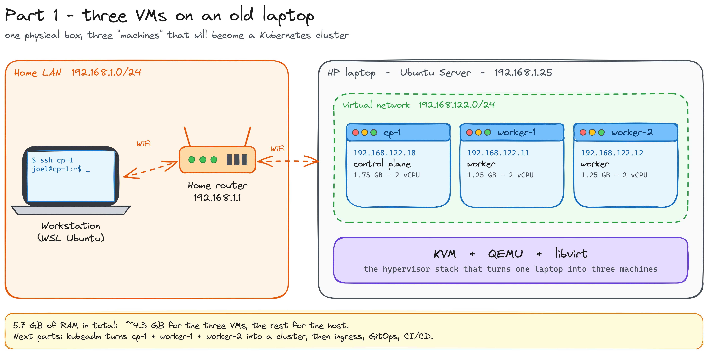

# k8s-homelab

Kubernetes on an old laptop, built by hand: KVM virtual machines, kubeadm, ingress, GitOps and CI/CD, with no managed services and no one-click installers.

The goal is to understand every layer, from the CPU's virtualization extensions up to a `git push` that deploys an app, and to document each step so anyone can follow along.



## Hardware

One old HP laptop: AMD Ryzen 7 3700U (4 cores / 8 threads), 5.7 GB of usable RAM, Ubuntu Server 24.04, running headless 24/7 on WiFi.

## Roadmap

| Phase | What | Status |
|---|---|---|
| 0 | **Host**: Ubuntu Server, SSH-only, hardening, BIOS virtualization | Done |
| 1 | **VMs**: KVM + QEMU + libvirt, cloud images, cloud-init, fixed IPs, ProxyJump | Done |
| 2 | **Cluster**: kubeadm, containerd, 1 control plane + 2 workers, Flannel | Next |
| 3 | **Traffic in**: Traefik + Gateway API, DNAT on the host, Cloudflare Tunnel | Planned |
| 4 | **GitOps & CI/CD**: GitHub Actions → GHCR → manifest repo → Argo CD | Planned |
| 5 | **Secrets**: Sealed Secrets, then External Secrets + GCP Secret Manager | Planned |
| 6 | **Workloads**: Go services, then my own GitOps operator in Go | Planned |

## Layout

```
.
├── scripts/
│   └── create-vms.sh      # Phase 1: creates cp-1, worker-1, worker-2
├── docs/
│   ├── guide.md           # full step-by-step guide, with the "why" of every step
│   ├── articles/          # blog posts, one per phase
│   └── diagrams/          # Excalidraw sources (.excalidraw) + PNG exports
└── README.md
```

## Read it

- **[Full guide](docs/guide.md)**: every command, what it does and why.
- **[Part 1: three VMs on an old laptop](docs/articles/part-1-three-vms-on-an-old-laptop.md)**: KVM vs QEMU vs libvirt, the libvirt network, DHCP reservations, qcow2 overlays, cloud-init and SSH ProxyJump.

Posts are also published on [runtimerants.dev](https://runtimerants.dev).

## Current setup

| VM | Role | IP | RAM | vCPU |
|---|---|---|---|---|
| `cp-1` | control plane | 192.168.122.10 | 1.75 GB | 2 |
| `worker-1` | worker | 192.168.122.11 | 1.25 GB | 2 |
| `worker-2` | worker | 192.168.122.12 | 1.25 GB | 2 |

All IPs are private (RFC 1918) and only reachable from inside the host.
