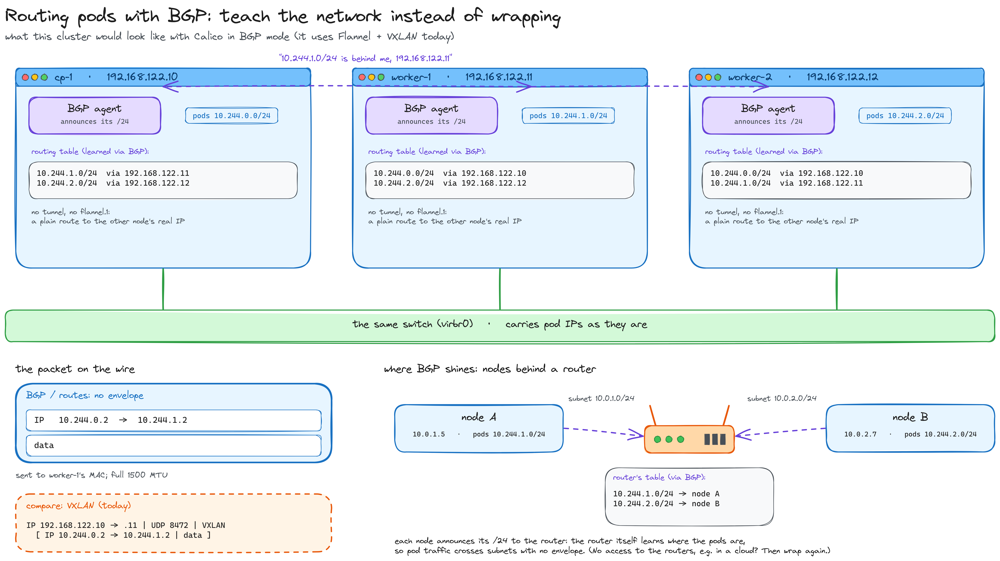

# Deep dive — Routing pods with BGP

*The other way to connect pods across nodes: instead of wrapping their packets, teach the network where they are*

[← Back to the VXLAN deep dive](../vxlan/README.md) · [Part 4](../../part-4-network/README.md) · [Index](../../../README.md)

> A side page. This cluster uses Flannel with VXLAN; this is what the alternative looks like, and why big clusters often prefer it.

## The same problem, the other answer

Pods on different nodes must reach each other **by their own IPs**, with no NAT in between. The network under the nodes doesn't know those IPs. Two ways out:

- **[VXLAN](../vxlan/README.md)**: hide the pod's packet inside a UDP packet between the nodes' real IPs;
- **routing**: tell the network where each node's `/24` is, so it can deliver pod packets **as they are**. Spreading those routes is the job of **BGP**.

## What BGP is

**BGP** (*Border Gateway Protocol*) is how **the routers of the Internet tell each other which networks they can reach**: *"to reach `80.58.0.0/16`, send it to me"*. Neighbours write the route down and pass it on. That's how the Internet knows how to reach anything without anyone configuring routes by hand.

## How a cluster uses it (Calico)

Each node runs a small BGP agent and behaves like an Internet router, with its own `/24`:

1. **`worker-1` announces**: *"`10.244.1.0/24` is behind me, `192.168.122.11`"*.
2. **The other nodes hear it and add a plain route**, no tunnel: `10.244.1.0/24 via 192.168.122.11`.
3. **A pod on `cp-1` sends to `10.244.1.2`**: the kernel sees the route and sends the packet **as it is** to `worker-1`'s MAC. On the wire: `10.244.0.2 → 10.244.1.2`, no envelope.
4. **`worker-1` receives it**, sees `10.244.1.2` is one of its own, and delivers it to the pod.

The pod IPs survive for the same reason as with VXLAN: nobody does NAT. The difference is that here the network **knows** where every IP is, so there's nothing to disguise.

## Two cases

- **Nodes on the same switch** (like these three on `virbr0`): the nodes only need to share routes among themselves. That's what Flannel's `host-gw` mode does too; Flannel reads the routes from the Kubernetes API, Calico spreads them with BGP.
- **Nodes on different subnets, with routers in between**: this is where BGP shines. Nodes announce their `/24`s **to the router**, the router learns the pod routes, and pod traffic crosses subnets with no envelope. Even machines outside the cluster could reach pods directly. (`host-gw` can't do this: it only sends to nodes on the same switch.) If you can't talk BGP with the routers, as in most clouds, you wrap again: Calico also has IP-in-IP and VXLAN modes.

## Side by side

| | VXLAN (this cluster) | Routes with BGP (Calico) |
|---|---|---|
| Idea | hide the pod packet in a UDP envelope | teach the network where each `/24` is |
| Who knows the pod IPs | only the nodes | the nodes, and the routers if you want |
| On the wire | `192.168.122.x` outside, `10.244.x.x` inside | `10.244.x.x` directly |
| Cost | 50 bytes per packet (MTU 1450), wrapping and unwrapping | nothing extra |
| Works on | any network | networks where routes can be shared (same switch, or routers that speak BGP) |

> **VXLAN** is putting your letter inside another envelope addressed somewhere the postman already knows. **BGP** is telling every post office that a new street exists, so they deliver straight to it.

[← Back to the VXLAN deep dive](../vxlan/README.md)
