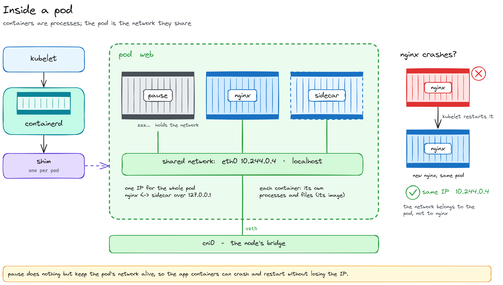

# Deep dive — What's inside a pod

*Containers, pods, and the `pause` container that does nothing*

[← Back to Part 4](../../part-4-network/README.md#15-how-a-pod-gets-its-ip-and-when-flannel-acts) · [Index](../../../README.md)

> A side page: not needed to follow the guide, but it explains the `pause` image from Part 3 and why a pod keeps its IP when its container restarts.



## Container vs pod

- **A container is a process**, isolated: its own processes (it's PID 1 inside), its own files (from its image), its own CPU and memory limits.
- **A pod is a group of containers sharing one network**: one IP, the same ports, the same `localhost`. nginx and a sidecar talk over `127.0.0.1`, but each keeps its own files.
- **Who starts them:** the kubelet asks containerd; containerd starts **one shim per pod**, the parent of that pod's containers. Docker uses the same pieces underneath (`dockerd → containerd → shim → runc`); Kubernetes just skips `dockerd`.

## Why `pause`

The pod's network has to live as long as the **pod**, not as long as nginx. When nginx crashes, the kubelet restarts it (`RESTARTS 1`), but it's the same pod and it must keep **the same IP**.

If the network belonged to nginx, it would die with nginx, and every restart would mean a new network and maybe a new IP. So the pod's network is created **first**, held by `pause`, a tiny container that just sleeps. nginx and the sidecar **join** it, and can come and go.

`pause` isn't a proxy: no traffic goes through it. It just keeps the network alive.

## See it yourself

> **Run on:** `cp-1`.

```bash
sudo crictl pods                  # one entry (and one pause) per pod
ps -ef | grep '/pause'            # one /pause process per pod
sudo ls /var/run/netns/           # one network per pod with its own IP (the two CoreDNS)
```

Kill a container and watch the IP stay (CoreDNS has two replicas, so DNS keeps working):

```bash
kubectl get pods -n kube-system -o wide | grep coredns
sudo crictl stop $(sudo crictl ps -q --name coredns | head -1)
kubectl get pods -n kube-system -o wide | grep coredns
```

<!-- TODO: real output -->

Same pod name, same IP, `RESTARTS 1`: a new container in the same pod.

[← Back to Part 4](../../part-4-network/README.md#15-how-a-pod-gets-its-ip-and-when-flannel-acts)
