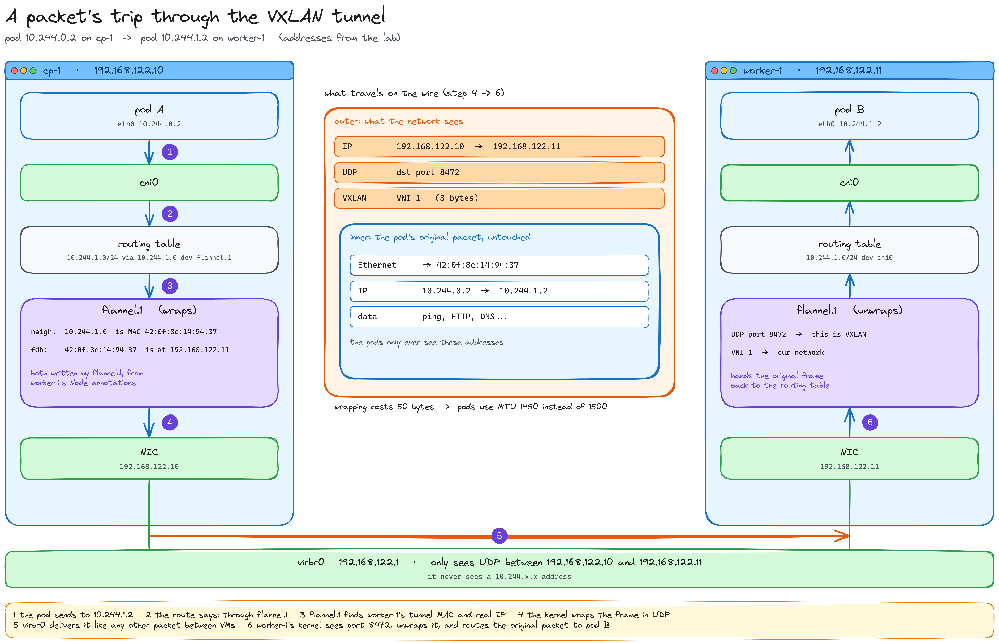

# Deep dive — How the VXLAN tunnel works

*How a packet for `10.244.1.2` crosses a network that has never heard of `10.244.1.2`*

[← Back to Part 4](../../part-4-network/README.md#14-what-flannel-built-on-the-node) · [Index](../../../README.md)

> A side page: not needed to follow the guide. It explains what `flannel.1` actually does with a packet.



## The problem

`virbr0` and the VMs only know `192.168.122.0/24`. If `cp-1` put a packet *"to `10.244.1.2`"* on the wire as it is, nobody would know where that is, and it would be dropped.

Two ways out:

- **teach the network the pod routes** (what Calico does with [BGP](../bgp/README.md), or Flannel's `host-gw` mode);
- **hide the pod's packet inside one the network already knows how to deliver.** That's VXLAN: **encapsulation**.

Nothing exotic: VXLAN is a standard (RFC 7348) built into the Linux kernel, the same thing data centers, cloud VPCs and Docker's overlay networks use. Flannel only configures it; the kernel does the wrapping.

## Why UDP

It's the simplest envelope there is:

- **every network understands it**: for `virbr0` it's ordinary UDP between `192.168.122.10` and `.11`;
- **no connection, no retransmissions**: if the packet inside is TCP, TCP already handles losses; doing it twice would only add work;
- **the port (8472) tells the receiving kernel "this is VXLAN"**, so it hands the packet to `flannel.1` instead of to an application.

What goes inside isn't just the pod's IP packet but the **whole Ethernet frame**, MACs included: VXLAN is a virtual layer-2 network carried in UDP.

## The trip, step by step

1. **Pod A** (`10.244.0.2`) sends to `10.244.1.2`: out through its veth into `cni0`, and into `cp-1`'s routing table.
2. **The route** `10.244.1.0/24 via 10.244.1.0 dev flannel.1` sends it into the tunnel.
3. **`flannel.1` looks up** the MAC of the other end (`10.244.1.0` → `42:0f:8c:14:94:37`) and the real IP behind that MAC (`192.168.122.11`). No ARP broadcast: `flanneld` filled both tables in advance from `worker-1`'s `Node` annotations (`VtepMAC`, `public-ip`).
4. **The kernel wraps** the frame: VXLAN header (`VNI 1`), UDP to port 8472, IP `192.168.122.10 → 192.168.122.11`.
5. **`virbr0` delivers it** like any other packet between VMs. It never sees a `10.244.x.x` address.
6. **`worker-1`'s kernel** sees UDP 8472, unwraps it, checks `VNI 1`, and hands the original frame to its `flannel.1`; from there the routing table sends it through `cni0` to pod B.

For both pods, they talked directly: no NAT, their own addresses on both ends.

## The numbers you've already seen

| Value | Where | Means |
|---|---|---|
| `VNI 1` | node annotation `backend-data` | the VXLAN network number (24 bits: up to 16 million networks, against 4096 VLANs). Every node uses `1` |
| `MTU 1450` | `/run/flannel/subnet.env` | the wrapping costs **50 bytes** (outer IP 20 + UDP 8 + VXLAN 8 + inner Ethernet 14), so pods send slightly smaller packets |
| `backend-type: vxlan` | node annotation | the mode Flannel is using |

## A curiosity of this cluster

The three VMs sit on **the same switch** (`virbr0`), so here the wrapping isn't even necessary: Flannel's `host-gw` mode would just add routes like `10.244.1.0/24 via 192.168.122.11`, faster and without the 50 extra bytes. VXLAN is the default because it works **anywhere**, even when nodes are separated by routers or live in a cloud.

> **Want the other approach?** How clusters route pods without any envelope: **[Deep dive: routing pods with BGP](../bgp/README.md)**

## See it yourself

> **Run on:** the worker where a pod is running, while `cp-1` pings that pod.

```bash
sudo tcpdump -ni enp1s0 udp port 8472
```

<!-- TODO: real capture from the smoke test -->

Each line shows both pairs of addresses: the outer `192.168.122.x` and, inside, the pods' `10.244.x.x`. (If the interface isn't called `enp1s0`, check with `ip -br addr`.)

[← Back to Part 4](../../part-4-network/README.md#14-what-flannel-built-on-the-node)
