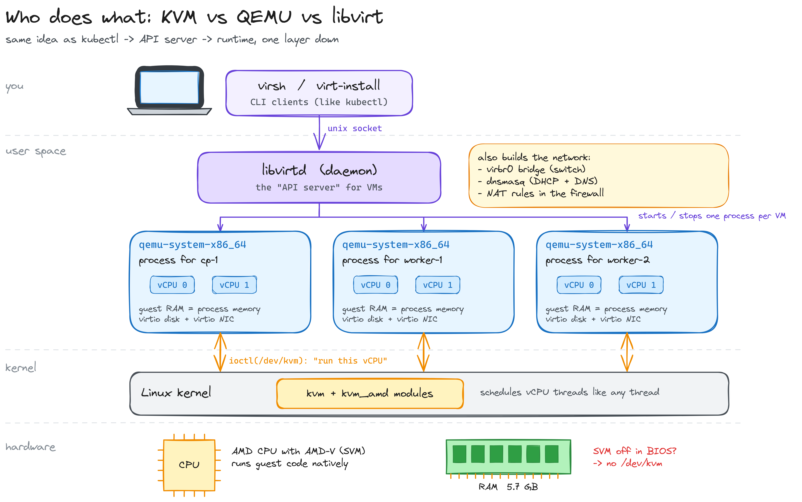
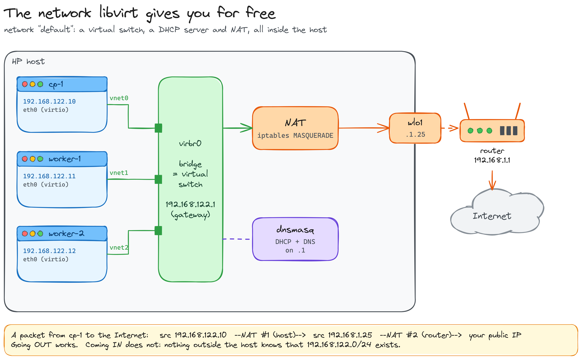
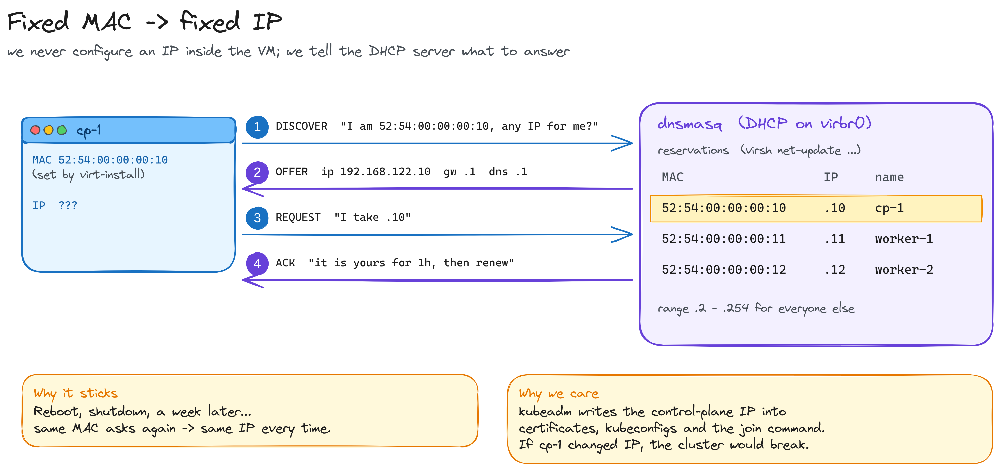
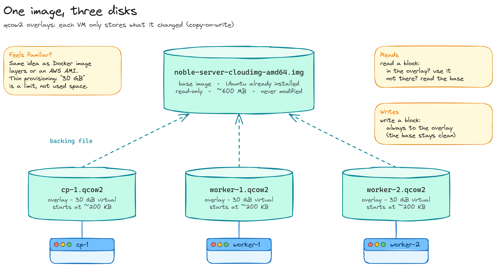
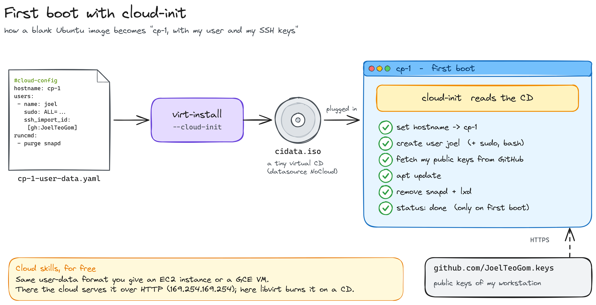
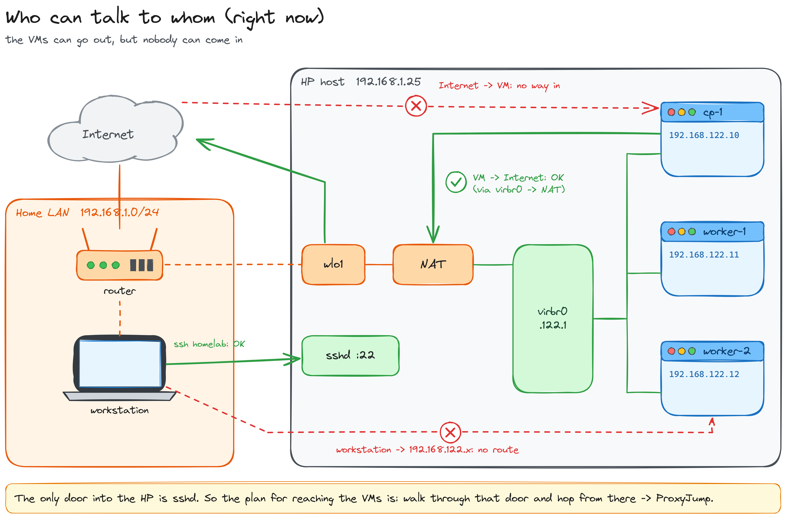
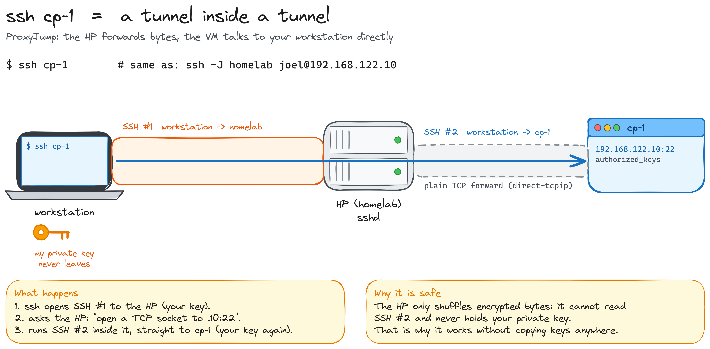

# Part 1 — Three VMs on an old laptop

*KVM, QEMU and libvirt from scratch*

[← Part 0: the host](../part-0-host/README.md) · [Index](../../README.md) · [Part 2: the nodes →](../part-2-nodes/README.md)

In [Part 0](../part-0-host/README.md) an old HP laptop became a headless Ubuntu server sitting on my desk. In this part we turn it into **three machines**: one control plane and two workers, ready for `kubeadm` in Part 2.

No Proxmox, no Multipass, no magic. Just the same three pieces that power a big chunk of the cloud underneath: **KVM, QEMU and libvirt**. Every step gets a "what just happened" and a command so you can see it for yourself.


What you'll end up with:

| VM | Role | IP | RAM | vCPU |
|---|---|---|---|---|
| `cp-1` | control plane | 192.168.122.10 | 1.75 GB | 2 |
| `worker-1` | worker | 192.168.122.11 | 1.25 GB | 2 |
| `worker-2` | worker | 192.168.122.12 | 1.25 GB | 2 |

> **Why so little RAM?** The HP has 5.7 GB usable. Three VMs take ~4.3 GB and the host keeps the rest. Tight, but enough for a kubeadm cluster, and tight is where you learn.

The plan:

1. Understand who does what (KVM vs QEMU vs libvirt)
2. Install the tools
3. Look at the network libvirt gives us for free
4. Pin an IP to each VM
5. One image, three disks
6. First boot with cloud-init
7. Create the VMs
8. Get in: SSH with ProxyJump

---

## 1. Who does what: KVM vs QEMU vs libvirt

People use these three names interchangeably. They are three different layers:



- **KVM** is a **kernel module** (`kvm` + `kvm_amd` on my AMD CPU). It uses the CPU's virtualization extensions (AMD-V / SVM) so guest code runs **natively** on the real CPU. KVM does CPU and memory, nothing else.
- **QEMU** is **one regular process per VM**. It *is* the machine: it emulates the disk controller, the network card, the firmware, and asks KVM, through `ioctl(/dev/kvm)`, to run the guest's vCPUs. Each vCPU is just a thread of that process, and the guest RAM is just that process's memory.
- **libvirt** is the **manager**. The `libvirtd` daemon starts and stops the QEMU processes, stores each VM's definition as XML, and builds the virtual network. `virsh` and `virt-install` are its CLI clients.

If you know Kubernetes, the mental model is: `virsh` is `kubectl`, `libvirtd` is the API server, the QEMU processes are the workloads.

> **Note:** without KVM, QEMU can still run a VM by translating every guest instruction in software (TCG). It works, and it's 10-50x slower. That's why step 0 in Part 0 was enabling SVM in the BIOS.

## 2. Install the tools

```bash
sudo apt install -y qemu-kvm libvirt-daemon-system libvirt-clients virtinst
sudo usermod -aG libvirt,kvm $USER     # log out and back in after this
```

What each package brings:

- `qemu-kvm`: QEMU, built to use KVM.
- `libvirt-daemon-system`: the `libvirtd` daemon, plus a ready-made network called `default`.
- `libvirt-clients`: `virsh`.
- `virtinst`: `virt-install`.

**See it yourself:**

```bash
lsmod | grep kvm            # kvm_amd + kvm loaded
ls -l /dev/kvm              # the door QEMU knocks on
virsh net-list --all        # "default  active  yes"
```

> **Tip:** `systemctl status libvirtd` may say *inactive*. That's fine: it's socket-activated and starts the moment a client like `virsh` connects.

## 3. The network libvirt gives you for free

When libvirt started the `default` network, it quietly built a small network inside the host:



- **`virbr0`** is a **bridge**, a virtual switch living in the kernel. Every VM gets plugged into it through a `vnetX` interface (a virtual cable).
- `virbr0` also has an IP, **`192.168.122.1`**. That's the **gateway** for the VMs: it's an interface of the host itself.
- **dnsmasq** is the DHCP + DNS server for that network. It hands each VM an IP, the gateway (.1) and a DNS server (.1).
- **NAT** rules in the host firewall rewrite `192.168.122.x` into the host's own IP (`192.168.1.25`) on the way out.

The subnet `192.168.122.0/24` isn't something we chose. It's libvirt's default.

**See it yourself:**

```bash
virsh net-dumpxml default   # the whole network, as XML
ip addr show virbr0         # the gateway IP lives on the host
```

> **Why not bridge the VMs straight onto my home network?** Because the HP is on WiFi, and WiFi in client mode can't bridge other MAC addresses through it. NAT is the way to go here. Wired Ethernet would allow a real bridge.

## 4. Pin an IP to each VM

Kubernetes needs stable addresses. `kubeadm` writes the control-plane IP into certificates, kubeconfigs and the `join` command. If `cp-1` woke up tomorrow with a different IP, the cluster would break.

We never configure an IP *inside* the VM. Instead, we tell the DHCP server what to answer:



```bash
for vm in "cp-1 10" "worker-1 11" "worker-2 12"; do
  set -- $vm
  virsh net-update default add ip-dhcp-host \
    "<host mac='52:54:00:00:00:$2' name='$1' ip='192.168.122.$2'/>" --live --config
done
```

- Each VM gets a **MAC address we choose**. When it boots and asks for an IP, dnsmasq looks up the MAC and always gives the same answer.
- `--live` applies the change to the running network now; `--config` saves it so it survives a reboot.
- `52:54:00` is the prefix QEMU uses for its virtual NICs. I just put the IP's last number at the end of the MAC so they're easy to remember.

**See it yourself:**

```bash
virsh net-dumpxml default | grep host
# <host mac='52:54:00:00:00:10' name='cp-1' ip='192.168.122.10'/>
# ...
```

> **Note:** the reserved IPs sit inside the dynamic range (`.2-.254`). dnsmasq never hands a reserved IP to anyone else, so it's fine. A tidier setup would shrink the range to `.100-.254` and keep the low numbers for fixed hosts.

## 5. One image, three disks

We don't install Ubuntu three times. We download an **Ubuntu cloud image** once (`noble-server-cloudimg-amd64.img`, ~600 MB): a disk with Ubuntu *already installed*, built to be cloned.

Each VM then gets a **qcow2 overlay** on top of it:



```bash
sudo qemu-img create -f qcow2 -F qcow2 \
  -b /var/lib/libvirt/images/noble-server-cloudimg-amd64.img \
  /var/lib/libvirt/images/cp-1.qcow2 30G
```

- `-b` is the **backing file**: the base image, which is never written to.
- Reads that miss the overlay fall through to the base; writes always land in the overlay (**copy-on-write**).
- `30G` is a **limit**, not used space. A fresh overlay is ~200 KB.

It's the same idea as Docker image layers or an AWS AMI.

## 6. First boot with cloud-init

A cloned disk is the same for every VM: no hostname, no user, no SSH keys. **cloud-init** fixes that on the first boot:



```yaml
#cloud-config
hostname: cp-1
users:
  - name: joel
    groups: sudo
    shell: /bin/bash
    sudo: ALL=(ALL) NOPASSWD:ALL
    ssh_import_id: [gh:JoelTeoGom]
package_update: true
runcmd:
  - [snap, remove, --purge, lxd]
  - [apt-get, purge, -y, snapd]
```

- `virt-install --cloud-init` packs this file into a **tiny ISO** and plugs it into the VM as a **CD-ROM** (the *NoCloud* datasource).
- On first boot, cloud-init finds the CD and applies it: hostname, user, sudo, packages.
- `ssh_import_id: gh:...` downloads my **public keys from GitHub** (`github.com/<user>.keys`) into `authorized_keys`. Those are the keys of my workstation.

> **Cloud skills, for free:** this is the exact same `user-data` you pass to an EC2 instance or a GCE VM. There, the cloud serves it over HTTP from `169.254.169.254` instead of a CD.

## 7. Create the VMs

Everything above, in one script. I keep the project in `~/homelab` (it'll become the repo):

```
~/homelab/
├── scripts/create-vms.sh
└── cloud-init/          # generated user-data, one per VM
```

```bash
#!/usr/bin/env bash
set -euo pipefail

IMG_DIR=/var/lib/libvirt/images
BASE=$IMG_DIR/noble-server-cloudimg-amd64.img
CI_DIR=$HOME/homelab/cloud-init
mkdir -p "$CI_DIR"

create_vm() {
  local name=$1 mem=$2 cpus=$3 mac=$4

  # 1. Overlay disk on top of the base image
  sudo qemu-img create -f qcow2 -F qcow2 -b "$BASE" "$IMG_DIR/$name.qcow2" 30G

  # 2. cloud-init config for the first boot
  cat > "$CI_DIR/$name-user-data.yaml" <<EOF
#cloud-config
hostname: $name
users:
  - name: joel
    groups: sudo
    shell: /bin/bash
    sudo: ALL=(ALL) NOPASSWD:ALL
    ssh_import_id: [gh:JoelTeoGom]
package_update: true
runcmd:
  - [snap, remove, --purge, lxd]
  - [apt-get, purge, -y, snapd]
EOF

  # 3. Define + boot the VM with a fixed MAC
  virt-install --name "$name" --memory "$mem" --vcpus "$cpus" \
    --import --disk path="$IMG_DIR/$name.qcow2",format=qcow2,bus=virtio \
    --os-variant ubuntu22.04 \
    --network network=default,model=virtio,mac="$mac" \
    --cloud-init user-data="$CI_DIR/$name-user-data.yaml" \
    --graphics none --noautoconsole

  # 4. Start with the host
  virsh autostart "$name"
}

create_vm cp-1      1792 2 52:54:00:00:00:10
create_vm worker-1  1280 2 52:54:00:00:00:11
create_vm worker-2  1280 2 52:54:00:00:00:12
```

A few flags worth knowing:

- `--import`: don't run an installer, the disk is already bootable.
- `bus=virtio` and `model=virtio`: paravirtualized disk and NIC. The guest knows it's a VM and talks to QEMU efficiently instead of pretending to be real hardware.
- `--graphics none`: headless, a serial console only.

Running it prints, for each VM:

```
WARNING  Requested memory 1792 MiB is less than the recommended 2048 MiB for OS ubuntu22.04
Allocating 'virtinst-...-cloudinit.iso'
Domain creation completed.
Domain 'cp-1' marked as autostarted
```

The warning is just a recommendation, and we're under it on purpose. The `cloudinit.iso` line is the CD from step 6.

**See it yourself:**

```bash
virsh list --all                  # 3 x running
virsh net-dhcp-leases default     # .10 .11 .12 with their MACs and hostnames
ps aux | grep [q]emu-system       # one process per VM
sudo ls -lh /var/lib/libvirt/images/   # tiny overlays next to the base
```

## 8. Who can talk to whom

We have three running VMs. Can we reach them? Not yet:



- **VM → Internet: OK.** Out through `virbr0`, NAT on the host, and NAT again on the router (double NAT). That's how `apt` and cloud-init work.
- **Internet → VM: no.** Nothing outside knows `192.168.122.0/24` exists.
- **Workstation → VM: no.** My workstation has no route to `192.168.122.x`; that network only lives inside the HP.
- **Workstation → HP: OK.** `sshd` on the host is the only door.

So the plan is to walk through that door and hop from there.

## 9. Get in: SSH with ProxyJump

On the workstation (WSL in my case), add this to `~/.ssh/config`, next to the `homelab` entry from Part 0:

```
Host cp-1
  HostName 192.168.122.10
Host worker-1
  HostName 192.168.122.11
Host worker-2
  HostName 192.168.122.12

Host cp-1 worker-1 worker-2
  User joel
  ProxyJump homelab
```

Now `ssh cp-1` just works. Under the hood it's a tunnel inside a tunnel:



1. SSH opens a connection to the HP (**SSH #1**), authenticated with my key.
2. Through it, it asks the HP to open a plain TCP connection to `192.168.122.10:22`.
3. It runs a second, independent SSH session (**SSH #2**) through that pipe, straight to `cp-1`, again with my key.

The HP only moves encrypted bytes around. It can't read SSH #2 and never holds my private key, which is why nothing had to be copied anywhere.

**See it yourself:**

```bash
ssh cp-1     'cloud-init status --wait; hostname'   # status: done / cp-1
ssh worker-1 'cloud-init status --wait; hostname'
ssh worker-2 'cloud-init status --wait; hostname'
```

## Things that bit me

**`ssh 192.168.122.10` from the HP → `Permission denied (publickey)`.** The VMs trust the keys from my GitHub, which are my *workstation's* keys. The HP has its own key (or none), which the VMs have never seen. That's not a bug: it's exactly why ProxyJump from the workstation is the right way in.

**Pasting commands under an `ssh` line.** I pasted `ssh ...` plus three commands meant for the VM. SSH failed, so the next lines ran **on the HP**, and the final `exit` closed my session on the HP. Use `ssh host 'cmd1; cmd2'` instead.

**`ls /var/lib/libvirt/images` → Permission denied.** That directory is root-only. Use `sudo ls`.

**`Could not resolve hostname cp-1`.** The `Host cp-1` block wasn't actually in `~/.ssh/config`. `ssh -G cp-1` prints the config SSH really uses; use it before anything else.

## Done when

- [x] `virsh list --all` shows three VMs running, with autostart
- [x] `virsh net-dhcp-leases default` shows .10, .11 and .12 for the right MACs
- [x] `ssh cp-1`, `ssh worker-1` and `ssh worker-2` work from the workstation
- [x] `cloud-init status` says `done` on all three

## Next: [Part 2](../part-2-nodes/README.md)

Three empty Ubuntu machines on a private network. In Part 2, `kubeadm` turns them into a Kubernetes cluster: container runtime, control plane on `cp-1`, workers joining, and a CNI so pods can talk.
