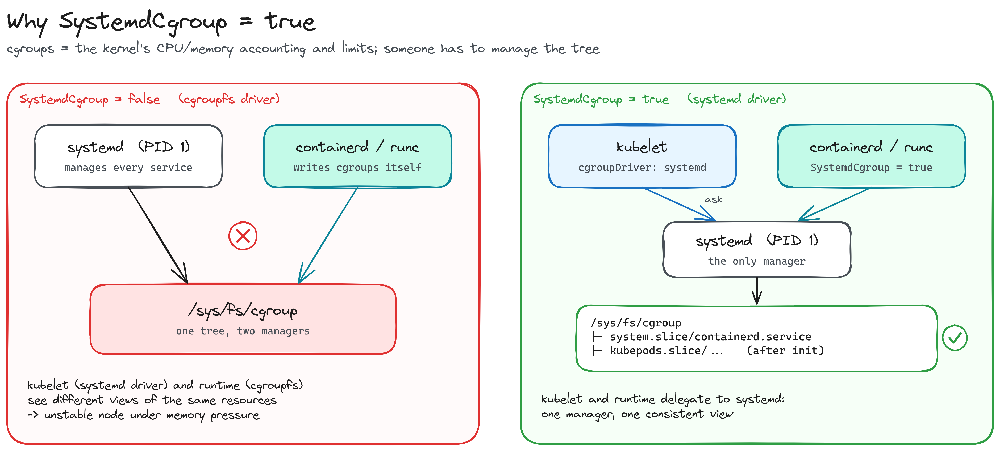
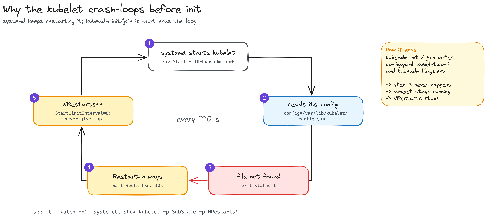
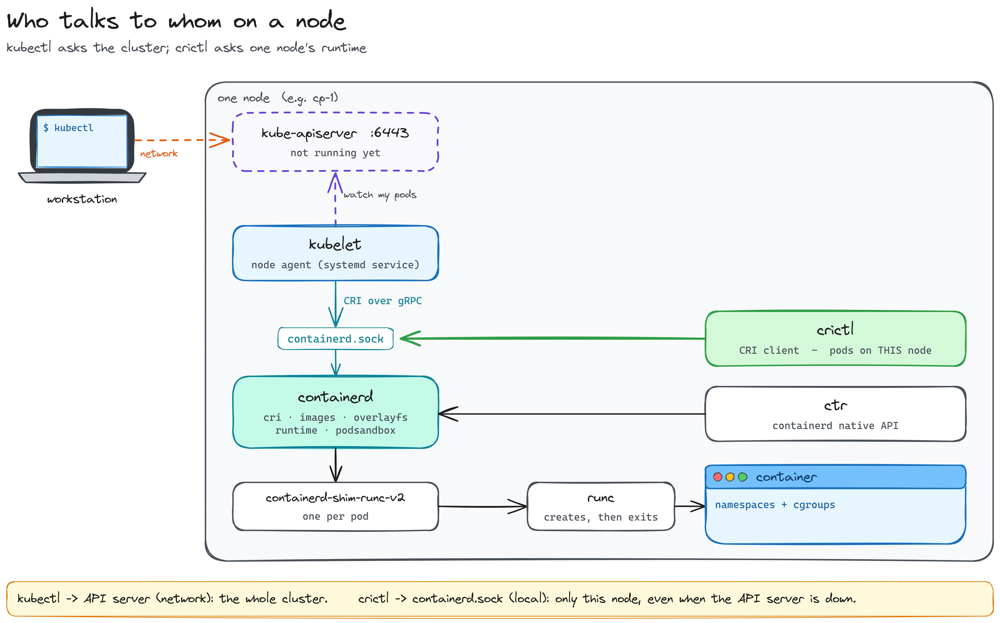
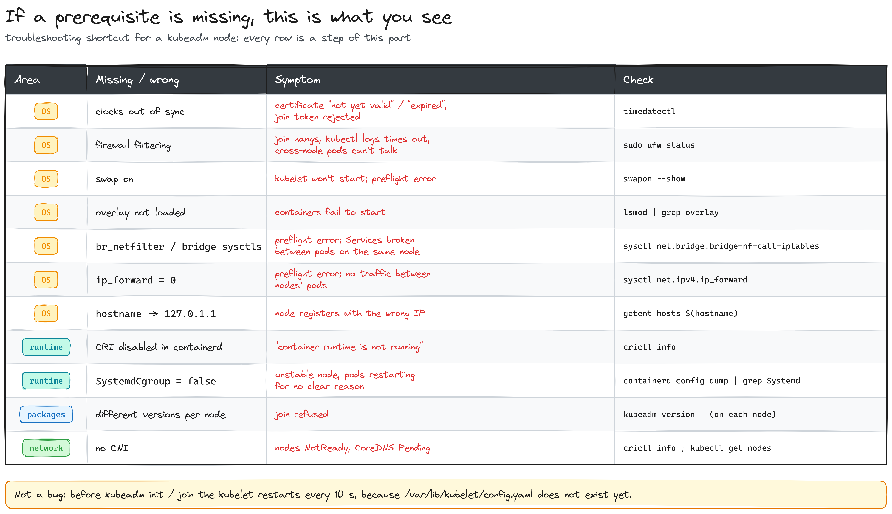

# Part 2 — A Kubernetes cluster with kubeadm

*Preparing three nodes by hand, then bootstrapping the cluster*

[← Part 1: three VMs](../part-1-vms/README.md) · [Index](../../README.md)

> **Status: in progress.** The nodes are ready (sections 1-5); the cluster itself (section 7) is next. Written while building it: every output below is from my lab.

[Part 1](../part-1-vms/README.md) left three empty Ubuntu VMs on a private network. In this part they become a Kubernetes cluster: **one control plane (`cp-1`) and two workers (`worker-1`, `worker-2`)**, built with `kubeadm` and nothing else.

| Node | Role | IP |
|---|---|---|
| `cp-1` | control plane | 192.168.122.10 |
| `worker-1` | worker | 192.168.122.11 |
| `worker-2` | worker | 192.168.122.12 |

The plan:

1. Get the OS ready for Kubernetes
2. Install a container runtime: containerd
3. Install kubeadm, kubelet and kubectl
4. Add crictl, a debugging client
5. Where we are (and what breaks if you skip a step)
6. What `kubeadm init` and `join` actually do
7. Bootstrap the cluster *(next)*

> **How to follow along.** Sections 1-4 run on **all three nodes**: `ssh cp-1`, run the commands, check the output, then repeat on `worker-1` and `worker-2`. Many kubeadm guides are written for RHEL-family distros (`dnf`, `firewalld`, SELinux); these nodes are Ubuntu 24.04, so everything here uses `apt`, `ufw` and AppArmor.

> **Tip:** before starting, snapshot the clean VMs on the host (`virsh snapshot-create-as <vm> clean-nodes` with the VM shut off). It's an undo button, and it lets you repeat the whole install as practice.

---

## 1. Get the OS ready for Kubernetes

Five checks, on every node. Most were already fine on a fresh Ubuntu cloud image, but each one exists because something specific breaks without it.

### Clocks in sync

Certificates, bootstrap tokens and etcd all assume the nodes agree on the time.

```bash
timedatectl status
# System clock synchronized: yes
#               NTP service: active
#           RTC in local TZ: no
```

All three were synchronized out of the box (Ubuntu uses `systemd-timesyncd`). The timezone is UTC, which is what you want on servers.

### No firewall in the way

Kubernetes components talk to each other on many ports: the API server (6443), etcd (2379-2380), every kubelet (10250), the pod network (Flannel's VXLAN on 8472/udp)... A firewall dropping any of them breaks the cluster in confusing ways.

```bash
sudo ufw status
# Status: inactive
```

`ufw` (Ubuntu's firewall front-end for iptables) comes inactive. The VMs sit on a private NAT network nothing outside the host can reach, so leaving it off is reasonable here. On an exposed network you'd keep it on and open those ports.

> **Gotcha:** `systemctl is-active ufw` says `active` even when the firewall is off: the unit runs once at boot and only applies rules if ufw is enabled. `sudo ufw status` is the real answer.

There's no SELinux to deal with either: that's RHEL's security module. Ubuntu uses AppArmor, and kubeadm works with it as is.

### Swap off

The scheduler places pods by comparing memory requests with the node's RAM, and a container over its memory limit is supposed to be OOM-killed. With swap, it would page to disk instead and crawl. So by default the kubelet refuses to start if swap is on.

```bash
swapon --show        # empty
free -h | grep Swap  # Swap: 0B 0B 0B
```

Cloud images ship without swap, so there was nothing to do. (If there were: `sudo swapoff -a` and comment out the swap line in `/etc/fstab`.)

> **Note:** this is about the **nodes**. The HP host has its own 4 GB of swap, and that's fine: the kubelet only sees its own VM.

### Kernel modules and network settings

```bash
cat <<EOF | sudo tee /etc/modules-load.d/k8s.conf
overlay
br_netfilter
EOF
sudo modprobe overlay
sudo modprobe br_netfilter

cat <<EOF | sudo tee /etc/sysctl.d/k8s.conf
net.bridge.bridge-nf-call-iptables  = 1
net.bridge.bridge-nf-call-ip6tables = 1
net.ipv4.ip_forward                 = 1
EOF
sudo sysctl --system
```

- **`overlay`**: the filesystem containerd uses to stack image layers into a container's `/`. Same idea as Part 1's qcow2 overlays, with files instead of disk blocks.
- **`br_netfilter`** + **`bridge-nf-call-iptables`**: make traffic crossing a Linux bridge (pod to pod on the same node) go through iptables, so Service rules apply to it.
- **`ip_forward`**: lets the node route packets between interfaces: pods, the node, other nodes.
- The files in `modules-load.d/` and `sysctl.d/` make it survive a reboot; `modprobe` and `sysctl --system` apply it now.

Each VM has its own kernel, so loading these on the host wouldn't help. A fresh Ubuntu just doesn't load them because nothing needed them yet.

**See it yourself:**

```bash
lsmod | grep -E 'overlay|br_netfilter'
sysctl net.bridge.bridge-nf-call-iptables net.ipv4.ip_forward   # both = 1
```

### Every node knows every other node

The kubelet registers the node under its hostname, and that name must resolve to the node's **real** IP, not `127.0.1.1` (some images add that line; then the node registers with the wrong address).

```bash
cat <<EOF | sudo tee -a /etc/hosts

# Kubernetes homelab nodes
192.168.122.10 cp-1
192.168.122.11 worker-1
192.168.122.12 worker-2
EOF

getent hosts cp-1 worker-1 worker-2   # all three, with their 192.168.122.x IPs
```

---

## 2. Install a container runtime: containerd

The kubelet never runs containers itself. It asks a **container runtime** through an API called the **CRI** (Container Runtime Interface). We use containerd, and under it a couple more pieces do the real work:

| Piece | Job |
|---|---|
| **kubelet** | node agent; talks CRI to containerd over a local socket |
| **containerd** | pulls images, stacks their layers, creates and supervises containers |
| **containerd-shim-runc-v2** | one small process per pod; keeps the container alive even if containerd restarts |
| **runc** | actually creates the container (namespaces + cgroups), then exits |

### Install it from Docker's repository

Docker's apt repository has a more up-to-date containerd than Ubuntu's own, packaged as `containerd.io`.

```bash
sudo apt-get update
sudo apt-get install -y ca-certificates curl
sudo install -m 0755 -d /etc/apt/keyrings
sudo curl -fsSL https://download.docker.com/linux/ubuntu/gpg -o /etc/apt/keyrings/docker.asc
sudo chmod a+r /etc/apt/keyrings/docker.asc
echo "deb [arch=$(dpkg --print-architecture) signed-by=/etc/apt/keyrings/docker.asc] https://download.docker.com/linux/ubuntu $(. /etc/os-release && echo $VERSION_CODENAME) stable" \
  | sudo tee /etc/apt/sources.list.d/docker.list > /dev/null
sudo apt-get update
sudo apt-get install -y containerd.io
```

- `docker.asc` is Docker's public key: apt uses it to verify every package from that repo was really signed by Docker.
- `docker.list` tells apt where the repo is; `signed-by=` ties it to that key. `$VERSION_CODENAME` is `noble` (24.04).

### Turn the CRI on

```bash
containerd config default | sudo tee /etc/containerd/config.toml > /dev/null
head -1 /etc/containerd/config.toml     # version = 3
```

The config shipped with the package is minimal and has `disabled_plugins = ["cri"]`: the very plugin the kubelet talks to is **off**. `containerd config default` prints the full default config built into the binary, and we save it in its place. `version = 3` is the config format of containerd 2.x (older guides use `version = 2`, and their `sed` commands don't match).

### Let systemd manage cgroups

```bash
sudo sed -i 's/SystemdCgroup = false/SystemdCgroup = true/' /etc/containerd/config.toml
sudo systemctl restart containerd
sudo systemctl enable containerd
```

This is the setting that matters most.



**cgroups** are the kernel feature that accounts and limits CPU and memory for groups of processes; a pod's `resources.limits` end up as cgroup settings. On Ubuntu, systemd (PID 1) already manages the cgroup tree for every service, and the kubelet uses the `systemd` driver. If containerd wrote cgroups on its own (`cgroupfs`), there would be **two managers for the same tree**, and under memory pressure the node gets unstable. `SystemdCgroup = true` makes containerd **delegate to systemd**, like the kubelet: one manager.

`restart` because containerd only reads its config at startup; `enable` so it starts on every boot.

**See it yourself.** containerd logs its config every time it starts:

```bash
sudo journalctl -u containerd --no-pager | grep -o '"SystemdCgroup":[a-z]*'
```

On `cp-1` that showed three starts, which tell the whole story:

| When | `SystemdCgroup` | |
|---|---|---|
| Oct 20 20:42:45 | `false` | first start after installing, before the `sed` |
| Oct 20 20:42:50 | `true` | the `restart` after the `sed` |
| Oct 23 14:30:02 | `true` | a later boot: it persists |

> `journalctl` needs `sudo`: without it you only see your own user's logs and the grep finds nothing.

```bash
ls -l /run/containerd/containerd.sock    # the 's' in the permissions = a socket
ss -xl | grep containerd                 # containerd.sock + containerd.sock.ttrpc
```

`containerd.sock` is a **Unix socket**: a "port" that lives as a file, for processes on the same machine. The kubelet will talk to containerd through it. The `.ttrpc` one is a lighter gRPC the shims use.

```bash
ctr plugins ls | grep -E 'cri|overlayfs'
```

containerd is one process with many plugins inside (not one process per plugin: `systemd-cgls` shows a single `/usr/bin/containerd`). The three that matter here are all `ok`:

- `cri.v1 images`: pulls images and stores their layers;
- `snapshotter.v1 overlayfs`: stacks those layers into the container's `/`, using the `overlay` module;
- `cri.v1 runtime`: starts the container on top, through a shim and runc.

The `skip` lines (`btrfs`, `zfs`, `devmapper`...) are snapshotters for filesystems this VM doesn't use. Expected.

---

## 3. Install kubeadm, kubelet and kubectl

| Package | What it is |
|---|---|
| **kubeadm** | the bootstrap tool: `init` builds the control plane, `join` adds a worker |
| **kubelet** | the node agent, a systemd service: takes orders from the API server and passes them to containerd |
| **kubectl** | the client that talks to the API server |

All three go on every node, the control plane included: its components (etcd, API server...) run as pods, and the kubelet is what starts them.

### Add the Kubernetes repository

Ubuntu doesn't ship Kubernetes, so we point apt at the official repo, `pkgs.k8s.io`. It has **one repo per minor version**: the URL decides which Kubernetes you get. I use **v1.34**, the version of the CKA exam I'm preparing.

```bash
sudo apt-get update
sudo apt-get install -y apt-transport-https ca-certificates curl gpg
curl -fsSL https://pkgs.k8s.io/core:/stable:/v1.34/deb/Release.key \
  | sudo gpg --dearmor -o /etc/apt/keyrings/kubernetes-apt-keyring.gpg
echo 'deb [signed-by=/etc/apt/keyrings/kubernetes-apt-keyring.gpg] https://pkgs.k8s.io/core:/stable:/v1.34/deb/ /' \
  | sudo tee /etc/apt/sources.list.d/kubernetes.list
```

Same pattern as Docker's repo: a signing key (`gpg --dearmor` converts it to the binary format apt expects) and the repo address.

> **Why packages and not the bare binaries?** You could copy `kubelet`, `kubeadm` and `kubectl` to `/usr/bin` by hand (*Kubernetes The Hard Way* does). The packages also give you the kubelet's systemd service already written, the dependencies (the base CNI plugins in `/opt/cni/bin`), signature checks, and controlled upgrades.

### Install and pin

```bash
sudo apt-get update
sudo apt-get install -y kubelet kubeadm kubectl
sudo apt-mark hold kubelet kubeadm kubectl
sudo systemctl enable --now kubelet
```

`apt-mark hold` freezes the versions so a routine `apt upgrade` can't touch them. Cluster upgrades should be deliberate: `kubeadm upgrade`, control plane first, one minor version at a time.

**See it yourself:**

```bash
kubeadm version -o short     # v1.34.12
kubelet --version            # Kubernetes v1.34.12
kubectl version --client     # Client Version: v1.34.12 · Kustomize Version: v5.7.1
apt-mark showhold            # kubeadm kubectl kubelet
```

Same version on all three nodes. The repo is `v1.34`; apt picked its latest patch, `.12`. And `kubectl` comes with Kustomize built in, which Part 4 will use.

### The kubelet crash-loops. That's expected.



```bash
watch -n1 'systemctl show kubelet -p ActiveState -p SubState -p NRestarts'
```

```
NRestarts=17
ActiveState=activating
SubState=auto-restart
```

`NRestarts` goes up by one every ~10 seconds. The log says why:

```bash
sudo journalctl -u kubelet -n 5 --no-pager
```

```
kubelet.service: Scheduled restart job, restart counter is at 48.
Started kubelet.service - kubelet: The Kubernetes Node Agent.
kubelet.service: Referenced but unset environment variable evaluates to an empty string: KUBELET_KUBEADM_ARGS
"command failed" err="failed to load kubelet config file, path: /var/lib/kubelet/config.yaml ... no such file or directory"
kubelet.service: Main process exited, code=exited, status=1/FAILURE
```

The kubelet starts, looks for its config file, doesn't find it, exits. Its service has `Restart=always`, `RestartSec=10` and `StartLimitInterval=0`, so systemd brings it back every 10 seconds and never gives up: a node agent is meant to always be running. `kubeadm init` / `join` will write that file (section 6), and the loop stops.

---

## 4. Add crictl, a debugging client

`crictl` doesn't come with kubeadm anymore, so it gets installed on its own. On a missing `crictl`, Ubuntu suggests `critcl`, an unrelated Tcl compiler: don't install that.

```bash
sudo apt-get install -y cri-tools
sudo apt-mark hold cri-tools
echo 'runtime-endpoint: unix:///run/containerd/containerd.sock' | sudo tee /etc/crictl.yaml
```

`/etc/crictl.yaml` tells it which runtime to talk to: `unix://` + the containerd socket from section 2.



`kubectl` asks the **cluster**, through the API server, over the network. `crictl` asks **one node's runtime**, through its local socket, the same CRI the kubelet uses. When the API server is down, `crictl` is how you see what's actually running on a node. (`ctr` also talks to containerd, but through its native API, not the CRI.)

**See it yourself:**

```bash
crictl info | grep -A12 '"conditions"'
```

```
{ "status": true,  "type": "RuntimeReady" },
{ "status": false, "type": "NetworkReady",
  "reason": "NetworkPluginNotReady",
  "message": "Network plugin returns error: cni plugin not initialized" }
```

- **`RuntimeReady: true`**: containerd works.
- **`NetworkReady: false`**: there's no pod network yet. Expected: it arrives with the CNI (section 7).

The network plugin side has two folders:

```bash
ls /opt/cni/bin/          # bridge  host-local  loopback  portmap  ...   (binaries)
sudo ls /etc/cni/net.d/   # (empty)                                       (config)
```

The binaries came with the `kubernetes-cni` package; the config folder is empty, which is exactly why `NetworkReady` is false. Flannel will drop its config there and reuse `bridge` and `host-local` to plug each pod in and give it an IP.

---

## 5. Where we are


Every node now has the OS prepared, containerd with CRI on and systemd cgroups, and the Kubernetes packages pinned at v1.34.12. What's missing is **the cluster itself**: no certificates, no etcd, no API server, no pod network.

If a node misbehaves later, start here: every row is one of the steps above, the symptom you'd see without it, and how to check.



---

## 6. What `kubeadm init` and `join` actually do

The kubelet already knows **where** its config will be: the package installed a kubeadm drop-in for its service.

```bash
systemctl cat kubelet
```

```ini
Environment="KUBELET_KUBECONFIG_ARGS=--bootstrap-kubeconfig=/etc/kubernetes/bootstrap-kubelet.conf --kubeconfig=/etc/kubernetes/kubelet.conf"
Environment="KUBELET_CONFIG_ARGS=--config=/var/lib/kubelet/config.yaml"
EnvironmentFile=-/var/lib/kubelet/kubeadm-flags.env
ExecStart=
ExecStart=/usr/bin/kubelet $KUBELET_KUBECONFIG_ARGS $KUBELET_CONFIG_ARGS $KUBELET_KUBEADM_ARGS $KUBELET_EXTRA_ARGS
```

(The `-` in `EnvironmentFile=-` means "fine if it doesn't exist", which is why the journal only warns about `KUBELET_KUBEADM_ARGS`. The empty `ExecStart=` clears the base unit's command before setting the new one.)

Right now both folders are empty:

```bash
tree /etc/kubernetes /var/lib/kubelet
# /etc/kubernetes
# └── manifests
# /var/lib/kubelet
```

`kubeadm init` (on `cp-1`) and `kubeadm join` (on the workers) fill them:

| File | Tells the kubelet |
|---|---|
| `/var/lib/kubelet/config.yaml` | how to behave: systemd cgroups, cluster DNS, where static pods live |
| `/var/lib/kubelet/kubeadm-flags.env` | node-specific flags: the containerd socket, the pause image |
| `/etc/kubernetes/kubelet.conf` | who to talk to and who it is: the API server address and its client certificate |

The difference between the two commands is how the node gets that certificate:

- **`init` on `cp-1`** creates the cluster CA, signs the kubelet's certificate itself, and writes the **static pod manifests** for etcd, the API server, the controller-manager and the scheduler into `/etc/kubernetes/manifests`. The kubelet on `cp-1` sees them and starts them: the control plane is just pods.
- **`join` on a worker** has no CA. It hands the kubelet a **bootstrap token**; the kubelet uses it to ask the API server for a certificate (**TLS bootstrap**), saves it, and registers itself as a node.

---

## 7. Bootstrap the cluster *(next)*

On `cp-1`, the flags that matter in this lab:

| Flag | Why |
|---|---|
| `--apiserver-advertise-address=192.168.122.10` | the IP baked into certificates and the join command: that's why `cp-1` got a fixed IP in Part 1 |
| `--pod-network-cidr=10.244.0.0/16` | Flannel's default range; doesn't overlap the VMs' `192.168.122.0/24` or the Services' `10.96.0.0/12` |
| `--apiserver-cert-extra-sans=127.0.0.1` | so `kubectl` can reach the API server from the workstation through an SSH tunnel later |

> **RAM:** kubeadm's preflight wants ~1700 MB on a control plane and `cp-1` has 1792 MiB. If it complains, `--ignore-preflight-errors=Mem` is acceptable in a lab.

> **Never commit** the `kubeadm join ...` line (it carries a token) or `/etc/kubernetes/admin.conf` (cluster-admin credentials).

*Coming next: `kubeadm init` with real output, the CNI, the workers joining, and a smoke test.*

---

## Things that bit me

- **Running the node loop on the host.** `for n in cp-1 ...; do ssh $n ...` from `joel@homelab` fails with `Could not resolve hostname cp-1`: those aliases only exist in the workstation's `~/.ssh/config`.
- **`journalctl` without `sudo`** shows `-- No entries --`: you only see your own user's logs.
- **`systemctl is-active ufw` says `active`** with the firewall off.
- **`crictl: command not found`**, and Ubuntu suggesting `critcl`: it's `cri-tools`.

## Done when (so far)

- [x] clocks synced, swap off, modules and sysctls set on all nodes
- [x] kubeadm, kubelet, kubectl v1.34.12, held, on all nodes
- [x] containerd with CRI on and `SystemdCgroup = true` on `cp-1`
- [ ] containerd, `/etc/hosts` and crictl confirmed on the workers
- [ ] `kubectl get nodes` → 3 nodes `Ready`
