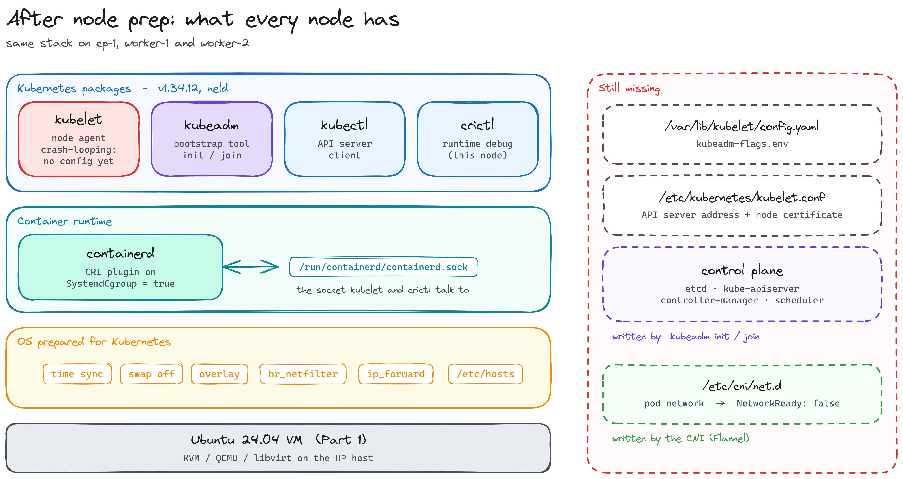
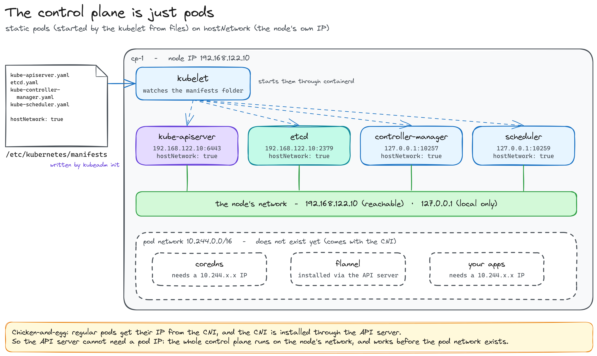
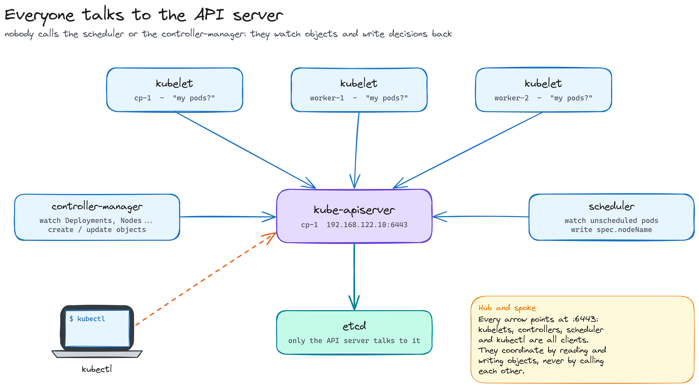
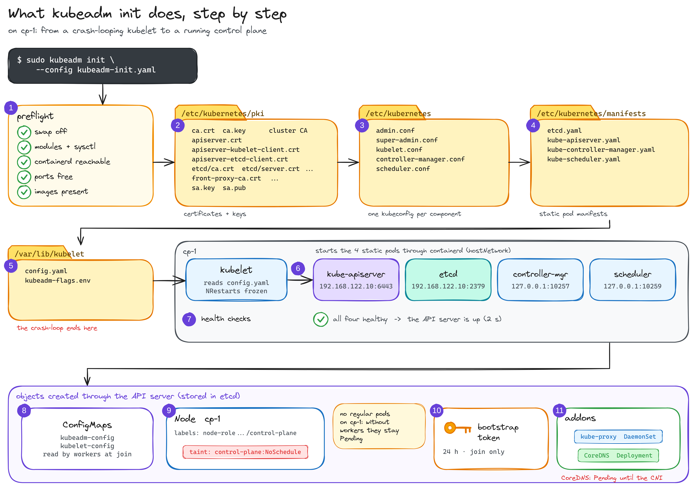
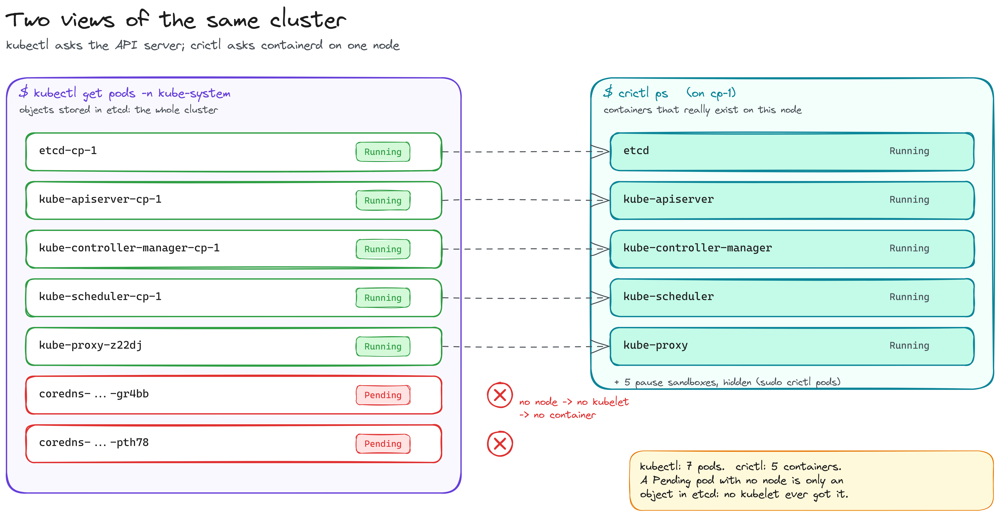
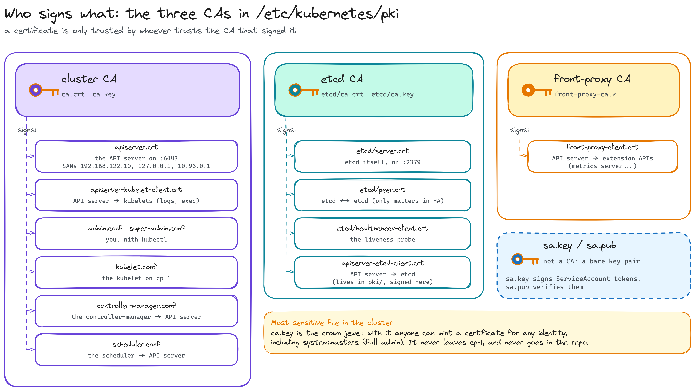

# Part 3 — The control plane

*`kubeadm init`, static pods, certificates and kubectl*

[← Part 2: preparing the nodes](../part-2-nodes/README.md) · [Index](../../README.md) · [Part 4: pod network and workers →](../part-4-network/README.md)

> Written while building it: every output below is from my lab.

[Part 2](../part-2-nodes/README.md) left three identical nodes: OS prepared, containerd running, Kubernetes packages installed, and a kubelet crash-looping because nothing has configured it yet. In this part `cp-1` becomes a control plane.



The plan:

1. What `kubeadm init` and `join` actually do
2. Bootstrap the control plane on `cp-1`: the config file, the images, `init`, kubectl, and a look at everything it created

The pod network and the workers joining come in [Part 4](../part-4-network/README.md).

---

## 1. What `kubeadm init` and `join` actually do

The kubelet already knows **where** its config will be: the package installed a kubeadm drop-in for its service.

```bash
systemctl cat kubelet
```

```ini
Environment="KUBELET_KUBECONFIG_ARGS=--bootstrap-kubeconfig=/etc/kubernetes/bootstrap-kubelet.conf --kubeconfig=/etc/kubernetes/kubelet.conf"
Environment="KUBELET_CONFIG_ARGS=--config=/var/lib/kubelet/config.yaml"
EnvironmentFile=-/var/lib/kubelet/kubeadm-flags.env
ExecStart=
ExecStart=/usr/bin/kubelet $KUBELET_KUBECONFIG_ARGS $KUBELET_CONFIG_ARGS $KUBELET_KUBEADM_ARGS $KUBELET_EXTRA_ARGS
```

(The `-` in `EnvironmentFile=-` means "fine if it doesn't exist", which is why the journal only warns about `KUBELET_KUBEADM_ARGS`. The empty `ExecStart=` clears the base unit's command before setting the new one.)

Right now both folders are empty:

```bash
tree /etc/kubernetes /var/lib/kubelet
# /etc/kubernetes
# └── manifests
# /var/lib/kubelet
```

`kubeadm init` (on `cp-1`) and `kubeadm join` (on the workers) fill them:

| File | Tells the kubelet |
|---|---|
| `/var/lib/kubelet/config.yaml` | how to behave: systemd cgroups, cluster DNS, where static pods live |
| `/var/lib/kubelet/kubeadm-flags.env` | node-specific flags: the containerd socket, the pause image |
| `/etc/kubernetes/kubelet.conf` | who to talk to and who it is: the API server address and its client certificate |

The difference between the two commands is how the node gets that certificate:

- **`init` on `cp-1`** creates the cluster CA, signs the kubelet's certificate itself, and writes the **static pod manifests** for etcd, the API server, the controller-manager and the scheduler into `/etc/kubernetes/manifests`. The kubelet on `cp-1` sees them and starts them: the control plane is just pods.
- **`join` on a worker** has no CA. It hands the kubelet a **bootstrap token**; the kubelet uses it to ask the API server for a certificate (**TLS bootstrap**), saves it, and registers itself as a node.

### The control plane is just pods

`init` doesn't install the control plane as services. It writes four YAML files into `/etc/kubernetes/manifests`, and the kubelet on `cp-1` starts them through containerd. These are **static pods**: pods the kubelet starts from files on disk, without asking the API server (it can't: the API server is one of them).



Each of those manifests also says `hostNetwork: true`. Two different ideas, both used by the control plane:

| | Means |
|---|---|
| **static pod** | **who starts it**: the kubelet, from a file, not the API server |
| **`hostNetwork: true`** | **which network it uses**: no pod IP from `10.244.0.0/16`; it shares the node's own network, so it listens on `192.168.122.10` |

So they do have an IP, the node's, and each one listens on its own port. Only the API server (`192.168.122.10:6443`) and etcd (`:2379-2380`) listen on the node's real address; the controller-manager (`127.0.0.1:10257`) and the scheduler (`127.0.0.1:10259`) only listen on localhost, because nobody outside the node needs to reach them (you'll see it in `init`'s output below).

**Why it has to be this way: a chicken-and-egg problem.** Regular pods get their IP from the CNI plugin (Flannel), and Flannel is installed *through the API server*. If the API server needed a pod IP, it could never start. Running the whole control plane on the node's network breaks the loop: it works before the pod network exists.

That's also why `advertiseAddress` must be the node's real IP, and why the three ranges must not overlap:

| Range | What |
|---|---|
| `192.168.122.0/24` | the VMs (Part 1): where the API server really listens |
| `10.244.0.0/16` | pod IPs, handed out by Flannel |
| `10.96.0.0/12` | Service IPs (virtual, implemented by kube-proxy) |

If the pod or Service range overlapped the VM network, a node would have two routes for the same addresses, and traffic to `192.168.122.10` could end up inside the pod network: the API server would become unreachable.

### Who talks to whom

If nobody has a pod IP in the control plane, how do you talk to the scheduler or the controller-manager? You don't. **Everything talks to the API server, and only to the API server:**



- The **scheduler** watches pods with no node assigned, picks one, and writes its decision back (`spec.nodeName`).
- The **controller-manager** watches objects (Deployments, ReplicaSets, Nodes...) and creates or updates others so reality matches the desired state.
- Every **kubelet** watches the pods assigned to its node and starts them.
- **Only the API server talks to etcd.**

The ports `:10257` and `:10259` exist only for health checks and metrics. The components never call each other: they coordinate by reading and writing objects in the API server.

---

## 2. Bootstrap the cluster

> **Run on:** `cp-1` only. The workers come later, with `kubeadm join`.

### 2.1 The config file

All the settings go in a file instead of a long line of flags: easier to read, and it can live in the repo.

```bash
cat <<EOF > kubeadm-init.yaml
apiVersion: kubeadm.k8s.io/v1beta4
kind: InitConfiguration
nodeRegistration:
  criSocket: "unix:///run/containerd/containerd.sock"
  kubeletExtraArgs:
    - name: node-ip
      value: "192.168.122.10"
localAPIEndpoint:
  advertiseAddress: "192.168.122.10"
---
apiVersion: kubeadm.k8s.io/v1beta4
kind: ClusterConfiguration
kubernetesVersion: "1.34.12"
apiServer:
  certSANs:
    - "127.0.0.1"
networking:
  podSubnet: "10.244.0.0/16"
  serviceSubnet: "10.96.0.0/12"
EOF
```

Two documents in one file:

- **`InitConfiguration`**: about **this node**.
- **`ClusterConfiguration`**: about **the whole cluster**.

| Field | Value | Why |
|---|---|---|
| `criSocket` | containerd's socket | how **this node's** kubelet reaches its runtime (it's under `nodeRegistration` because each node could run a different one). kubeadm passes it to the kubelet as `--container-runtime-endpoint`. With containerd it's always this path |
| `node-ip` | `192.168.122.10` | the IP the kubelet registers for this node. Matters on machines with several interfaces; here it's explicit to avoid surprises |
| `advertiseAddress` | `192.168.122.10` | the IP the API server announces and gets baked into its certificate and the join command: that's why `cp-1` has a fixed IP since Part 1 |
| `kubernetesVersion` | `1.34.12` | must match the installed kubeadm and kubelet |
| `certSANs` | `127.0.0.1` | extra name on the API server certificate, so `kubectl` can reach it later through an SSH tunnel from the workstation |
| `podSubnet` | `10.244.0.0/16` | the range pod IPs come from. **The CNI must use the same one**: Flannel's config (`net-conf.json` → `Network`) defaults to `10.244.0.0/16`, which is why we picked it |
| `serviceSubnet` | `10.96.0.0/12` | Kubernetes' default |

`v1beta4` is the version of kubeadm's config format. In it, `kubeletExtraArgs` is a list of `name`/`value`; older guides use `v1beta3`, where it was a map.

### About the bootstrap token

Some guides hard-code a token in this file (`token: "123456.1234567890123456"`, `ttl: "0s"`). We leave it out on purpose.

The **bootstrap token** is a one-time password for `kubeadm join`: a new node uses it once to introduce itself to the cluster and get its own certificate (the TLS bootstrap from section 1). It's stored as a Secret in `kube-system` (`bootstrap-token-<id>`), in the form `<id>.<secret>`.

| When | Who | What happens |
|---|---|---|
| `kubeadm init` | kubeadm | with no token in the config, generates a **random one valid for 24 h** and prints the full `kubeadm join ...` command |
| joining | you | run that command on each worker |
| it expires | Kubernetes | the controller-manager's *tokencleaner* deletes expired tokens |
| a new node, days later | you | `sudo kubeadm token create --print-join-command` |

Expiry doesn't affect nodes that already joined: after `join`, each kubelet has **its own certificate**, rotates it automatically, and never uses the token again.

A fixed token with `ttl: "0s"` is handy for automation (a script can join workers without reading `init`'s output), but it **never expires**: anyone who sees it can add machines to your cluster forever. Without it, the config file holds no secrets and can live in the repo.

The printed join command carries two things, one for each direction of trust:

```
kubeadm join 192.168.122.10:6443 --token <id>.<secret> \
    --discovery-token-ca-cert-hash sha256:<hash>
```

- `--token`: the **worker** proves to the cluster it's allowed in.
- `--discovery-token-ca-cert-hash`: the worker checks the **cluster** is the real one (the hash must match `cp-1`'s CA), so it can't be tricked into joining a fake API server.

### 2.2 Validate and pre-pull the images

```bash
sudo kubeadm config validate --config kubeadm-init.yaml
sudo kubeadm config images list --config kubeadm-init.yaml
sudo kubeadm config images pull --config kubeadm-init.yaml
sudo crictl images
```

- `validate` checks the YAML without touching anything: a wrong indent shows up now, not halfway through `init`.
- `images list` / `pull` fetch the control plane images. kubeadm doesn't download them itself: it asks containerd, through the CRI.
- `crictl images` shows them stored in containerd.

On `cp-1`:

```
registry.k8s.io/kube-apiserver:v1.34.12
registry.k8s.io/kube-controller-manager:v1.34.12
registry.k8s.io/kube-scheduler:v1.34.12
registry.k8s.io/kube-proxy:v1.34.12
registry.k8s.io/coredns/coredns:v1.12.1
registry.k8s.io/pause:3.10.1
registry.k8s.io/etcd:3.6.5-0
```

Seven images, and how each one will run:

| Image | What it is | Runs as |
|---|---|---|
| `kube-apiserver` | the API server | static pod on `cp-1`, `hostNetwork` |
| `kube-controller-manager` | the controllers | static pod on `cp-1`, `hostNetwork` |
| `kube-scheduler` | picks a node for each pod | static pod on `cp-1`, `hostNetwork` |
| `etcd` | the cluster's database | static pod on `cp-1`, `hostNetwork` |
| `kube-proxy` | writes the iptables rules behind Services | **DaemonSet**: one pod per node, also `hostNetwork` |
| `coredns` | the cluster DNS (`my-svc.default.svc.cluster.local`) | **Deployment**: needs a pod IP, so it stays `Pending` until the CNI exists |
| `pause` | the empty container in every pod | holds the pod's network namespace; the pod's other containers join it |

The first four are the static pods from the diagram. kube-proxy and CoreDNS are not: kubeadm creates them **through the API server** once it's up.

```
IMAGE                                     TAG        SIZE
registry.k8s.io/coredns/coredns           v1.12.1    22.4MB
registry.k8s.io/etcd                      3.6.5-0    22.9MB
registry.k8s.io/kube-apiserver            v1.34.12   27.4MB
registry.k8s.io/kube-controller-manager   v1.34.12   23.1MB
registry.k8s.io/kube-proxy                v1.34.12   27.4MB
registry.k8s.io/kube-scheduler            v1.34.12   17.7MB
registry.k8s.io/pause                     3.10.1     320kB
```

`crictl images` shows them already stored in containerd: `init` won't need to download anything.

### 2.3 Align the pause image with kubeadm

> **Run on:** every node (`cp-1`, `worker-1`, `worker-2`).

Every pod starts with a tiny `pause` container that holds its network namespace. **containerd** creates it, using the image set in **its own** config, not the one kubeadm just pulled. And they don't match:

```bash
sudo containerd config dump | grep -i 'sandbox ='
#   sandbox = 'registry.k8s.io/pause:3.10.2'      ← containerd
# kubeadm config images list                     → registry.k8s.io/pause:3.10.1
```

It would still work: containerd would just pull `3.10.2` the first time it creates a pod, and the `3.10.1` kubeadm pre-pulled would never be used. But you end up with two versions, `kubeadm init` warns about it ("the sandbox image of the container runtime is inconsistent with that used by kubeadm"), and in an air-gapped cluster, where only the pre-pulled images exist, pods wouldn't start. The kubeadm documentation recommends making the runtime's sandbox image match the one kubeadm uses.

```bash
sudo sed -i "s#sandbox = 'registry.k8s.io/pause:3.10.2'#sandbox = 'registry.k8s.io/pause:3.10.1'#" /etc/containerd/config.toml
sudo systemctl restart containerd
sudo containerd config dump | grep -i 'sandbox ='    # registry.k8s.io/pause:3.10.1
```

- In containerd 2.x the line lives under `pinned_images`: a **pinned** image is also protected from image garbage collection.
- `restart`, because containerd only reads its config at startup (Part 2).
- On **every** node: the workers create `pause` containers too, one per pod they run.

### 2.4 Run `kubeadm init`

> **RAM:** kubeadm's preflight wants ~1700 MB on a control plane and `cp-1` has 1792 MiB. If it complains, add `--ignore-preflight-errors=Mem` (acceptable in a lab).

```bash
sudo kubeadm init --config kubeadm-init.yaml
```

(Without `sudo`, preflight stops right away with `[ERROR IsPrivilegedUser]: user is not running as root`: `init` writes to `/etc/kubernetes`, `/var/lib/kubelet` and system settings.)

The output on `cp-1`, trimmed, and what each phase did:

```
[init] Using Kubernetes version: v1.34.12
[preflight] Running pre-flight checks
[certs] Generating "ca" certificate and key
[certs] apiserver serving cert is signed for DNS names [cp-1 kubernetes kubernetes.default kubernetes.default.svc kubernetes.default.svc.cluster.local] and IPs [10.96.0.1 192.168.122.10 127.0.0.1]
[kubeconfig] Writing "admin.conf" / "super-admin.conf" / "kubelet.conf" / "controller-manager.conf" / "scheduler.conf"
[etcd] Creating static Pod manifest for local etcd in "/etc/kubernetes/manifests"
[control-plane] Creating static Pod manifest for "kube-apiserver" / "kube-controller-manager" / "kube-scheduler"
[kubelet-start] Writing kubelet configuration to file "/var/lib/kubelet/config.yaml"
[kubelet-start] Starting the kubelet
[control-plane-check] Checking kube-apiserver at https://192.168.122.10:6443/livez
[control-plane-check] Checking kube-controller-manager at https://127.0.0.1:10257/healthz
[control-plane-check] Checking kube-scheduler at https://127.0.0.1:10259/livez
[control-plane-check] kube-apiserver is healthy after 2.00306362s
[upload-config] Storing the configuration used in ConfigMap "kubeadm-config" in the "kube-system" Namespace
[mark-control-plane] Marking the node cp-1 as control-plane by adding the taints [node-role.kubernetes.io/control-plane:NoSchedule]
[bootstrap-token] Using token: <redacted>
[addons] Applied essential addon: CoreDNS
[addons] Applied essential addon: kube-proxy

Your Kubernetes control-plane has initialized successfully!
```

Everything `init` did, in order:



The same, phase by phase:

| Phase | What happened |
|---|---|
| `preflight` | the checks Part 2 prepared for: swap, modules, sysctls, runtime, ports. No errors |
| `certs` | the cluster **CA** and every certificate, in `/etc/kubernetes/pki` |
| `kubeconfig` | **one kubeconfig per component**: the scheduler and the controller-manager are API server **clients**, each with its own identity (the hub and spoke above) |
| `etcd`, `control-plane` | the four **static pod manifests** in `/etc/kubernetes/manifests` |
| `kubelet-start` | writes `config.yaml` and `kubeadm-flags.env` and starts the kubelet: **the crash-loop from Part 2 ends here** |
| `control-plane-check` | waits until all four answer. The controller-manager and scheduler are checked on `127.0.0.1`: they only listen on localhost |
| `upload-config` | stores the cluster config in ConfigMaps; workers read them during `join` |
| `mark-control-plane` | labels `cp-1` and adds the **`NoSchedule` taint**: regular workloads won't land on the control plane |
| `bootstrap-token` | the 24 h token, plus the RBAC rules that let new nodes request and get their certificate |
| `addons` | CoreDNS and kube-proxy, created **through the API server** (not static pods) |

> **The taint in practice.** A pod without a matching toleration is still created, but the scheduler never places it on `cp-1`: with no workers yet, it stays `Pending`, and `kubectl describe pod` shows `0/1 nodes are available: 1 node(s) had untolerated taint {node-role.kubernetes.io/control-plane: }`. System pods that must run everywhere (kube-proxy, Flannel) and CoreDNS carry that toleration, so they do run on `cp-1`.

> **Did the kubelet need to be running before `init`?** Not really: `init` (re)starts it itself (`[kubelet-start] Starting the kubelet`). What matters is that it's **enabled**, so it comes back on every boot. And it can't be a pod: something outside containers has to start the static pods. That's why the kubelet is a plain binary run by systemd.

The API server certificate (the `[certs]` line) is valid for `192.168.122.10` (`advertiseAddress`), **`127.0.0.1`** (our `certSANs`, for the SSH tunnel later) and **`10.96.0.1`**: the IP of the `kubernetes` Service, which is how pods reach the API server from inside the cluster.

The end of the output prints the join command for the workers. Copy it somewhere safe on `cp-1`; it's needed in Part 4 and **never goes in the repo**:

```
kubeadm join 192.168.122.10:6443 --token <redacted> \
        --discovery-token-ca-cert-hash sha256:<redacted>
```

> **Never commit** the `kubeadm join ...` line printed at the end of `init` (it carries the token) or `/etc/kubernetes/admin.conf` (cluster-admin credentials).

### 2.5 Use kubectl as your user

```bash
mkdir -p $HOME/.kube
sudo cp -i /etc/kubernetes/admin.conf $HOME/.kube/config
sudo chown $(id -u):$(id -g) $HOME/.kube/config
```

Before this, `kubectl` fails in a confusing way:

```
$ kubectl get pods -n kube-system
The connection to the server localhost:8080 was refused - did you specify the right host or port?
```

`kubectl` is just a client binary, not a running service: each time you run it, it reads a **kubeconfig**, makes HTTPS requests to the API server, prints the answer and exits. It looks for that kubeconfig in this order:

1. the `--kubeconfig` flag;
2. the `KUBECONFIG` environment variable;
3. `~/.kube/config`.

With none of them, it falls back to `http://localhost:8080`, where nothing listens. The API server is at `https://192.168.122.10:6443`, and the only file that says so is `/etc/kubernetes/admin.conf`: the API server address plus a client certificate with admin rights. We copy it to the default path and make it ours.

```bash
kubectl config view    # server: https://192.168.122.10:6443 · user: kubernetes-admin (certificates hidden)
```

### 2.6 Check the control plane

First, is the API server answering?

```bash
kubectl cluster-info
```

```
Kubernetes control plane is running at https://192.168.122.10:6443
CoreDNS is running at https://192.168.122.10:6443/api/v1/namespaces/kube-system/services/kube-dns:dns/proxy
```

The first line is the address from the kubeconfig, and getting any answer at all proves the API server is up. The second line is misleading: it only means the `kube-dns` **Service** exists (an object kubeadm created). The CoreDNS pods behind it aren't running yet, as the next command shows.

```bash
kubectl get nodes
```

```
NAME   STATUS     ROLES           AGE     VERSION
cp-1   NotReady   control-plane   4h11m   v1.34.12
```

- **`NotReady` is expected.** The kubelet reports `NetworkReady: false`, the same thing `crictl info` showed in Part 2: without a CNI plugin the node can't set up pod networking, so Kubernetes doesn't consider it ready.
- **`ROLES: control-plane`** is the label from `[mark-control-plane]`.
- Add `-o wide` and **`INTERNAL-IP` must be `192.168.122.10`**: proof that `node-ip` in the config file (and the clean `/etc/hosts` from Part 2) did their job. `CONTAINER-RUNTIME` shows the containerd found through `criSocket`.

```bash
kubectl get pods -n kube-system -o wide
```

```
NAME                           READY   STATUS    IP               NODE
coredns-66bc5c9577-gr4bb       0/1     Pending   <none>           <none>
coredns-66bc5c9577-pth78       0/1     Pending   <none>           <none>
etcd-cp-1                      1/1     Running   192.168.122.10   cp-1
kube-apiserver-cp-1            1/1     Running   192.168.122.10   cp-1
kube-controller-manager-cp-1   1/1     Running   192.168.122.10   cp-1
kube-proxy-z22dj               1/1     Running   192.168.122.10   cp-1
kube-scheduler-cp-1            1/1     Running   192.168.122.10   cp-1
```

What each one is, briefly:

| Pod | What it does | Created as |
|---|---|---|
| `kube-apiserver-cp-1` | the front door: every component and every `kubectl` talks to it | static pod |
| `etcd-cp-1` | the database where every object lives; only the API server talks to it | static pod |
| `kube-controller-manager-cp-1` | the control loops: keeps Deployments, ReplicaSets, Nodes... matching their desired state | static pod |
| `kube-scheduler-cp-1` | picks a node for every new pod | static pod |
| `kube-proxy-z22dj` | turns Services into iptables rules on its node | DaemonSet (one per node) |
| `coredns-...` (×2) | the cluster DNS: `my-service` → its Service IP | Deployment |

What the output shows:

- **Every running pod has the node's IP, `192.168.122.10`**: `hostNetwork`, exactly as in the static pods diagram.
- **The `-cp-1` suffix** marks a **mirror pod**: the kubelet starts static pods from files and publishes a read-only copy to the API server so `kubectl` can show them. `kubectl delete` on one just makes it reappear: the file in `/etc/kubernetes/manifests` is what counts.
- **`kube-proxy-z22dj`** has a random suffix: a regular pod, created by its DaemonSet.
- **CoreDNS is `Pending`, with no IP and no node.** Its name tells the chain: Deployment `coredns` → ReplicaSet `coredns-66bc5c9577` (a hash of the pod template) → pods. They're not even scheduled: while the node is `NotReady`, Kubernetes adds a second taint, `node.kubernetes.io/not-ready:NoSchedule`, which CoreDNS doesn't tolerate. It also needs a pod IP, which only the CNI can give.

The same thing seen from below, from the runtime on `cp-1`:

```bash
crictl ps
```

```
CONTAINER       IMAGE           STATE     NAME                      ATTEMPT   POD
67a75aaa1d84f   0efaa42028c62   Running   kube-proxy                0         kube-proxy-z22dj
b4ab888783d17   49c761f7baec3   Running   kube-apiserver            0         kube-apiserver-cp-1
aa8f295e9d7ad   83f502a2da0cf   Running   kube-controller-manager   0         kube-controller-manager-cp-1
0dd48c3745ad2   6e8ebd9a89d52   Running   kube-scheduler            0         kube-scheduler-cp-1
69643eba57b94   a3e246e9556e9   Running   etcd                      0         etcd-cp-1
```

- `kubectl` asks the **API server** and lists 7 pods; `crictl` asks **containerd on this node** and finds 5 containers. The CoreDNS pods aren't here: a `Pending` pod with no node is **just an object in etcd**. No kubelet received it, so no container exists anywhere.
- The `IMAGE` IDs are the ones `crictl images` listed in 2.2: the images pre-pulled before `init`.
- `ATTEMPT 0`: none of them has restarted in 4 hours.
- Each pod also has a `pause` container (its sandbox) that `crictl ps` hides. `sudo crictl pods` lists the 5 sandboxes, one per pod, with the same pod IDs.



> **Why two CoreDNS pods?** kubeadm deploys CoreDNS as a Deployment with `replicas: 2`, for redundancy: if one node goes down, the other replica keeps answering DNS. Once there are workers, the scheduler spreads them out. See it with `kubectl get deployment -n kube-system` (`coredns 0/2`).

> **Why does plain `kubectl get pods` say "No resources found"?** Without `-n`, kubectl looks at the **`default` namespace**, which is empty: nothing of ours is deployed yet. System components live in **`kube-system`**. `kubectl get namespaces` lists them all (`default`, `kube-system`, `kube-public` with the `cluster-info` ConfigMap for joining nodes, `kube-node-lease` with each node's heartbeat); `kubectl get pods -A` shows pods in every namespace.

Both taints, and the reason CoreDNS waits, are visible with `describe`:

```bash
kubectl describe node cp-1 | grep -A3 Taints
#   node-role.kubernetes.io/control-plane:NoSchedule
#   node.kubernetes.io/not-ready:NoSchedule
kubectl describe pod -n kube-system -l k8s-app=kube-dns | grep -A5 Events
#   Warning  FailedScheduling  ...  untolerated taint {node.kubernetes.io/not-ready: }
```

And the crash-loop from Part 2 is over: the kubelet has its config now and stays up.

```bash
systemctl show kubelet -p SubState -p NRestarts
# SubState=running, and NRestarts stops growing
```

Once the CNI is in ([Part 4](../part-4-network/README.md)), the node goes `Ready`, the `not-ready` taint is removed, and CoreDNS gets scheduled with the first **`10.244.x.x`** IP of the cluster.

### 2.7 What got created

```bash
tree /etc/kubernetes
```

```
/etc/kubernetes/
├── admin.conf
├── controller-manager.conf
├── kubelet.conf
├── manifests
│   ├── etcd.yaml
│   ├── kube-apiserver.yaml
│   ├── kube-controller-manager.yaml
│   └── kube-scheduler.yaml
├── pki
│   ├── apiserver-etcd-client.crt
│   ├── apiserver-etcd-client.key
│   ├── apiserver-kubelet-client.crt
│   ├── apiserver-kubelet-client.key
│   ├── apiserver.crt
│   ├── apiserver.key
│   ├── ca.crt
│   ├── ca.key
│   ├── etcd
│   │   ├── ca.crt
│   │   ├── ca.key
│   │   ├── healthcheck-client.crt
│   │   ├── healthcheck-client.key
│   │   ├── peer.crt
│   │   ├── peer.key
│   │   ├── server.crt
│   │   └── server.key
│   ├── front-proxy-ca.crt
│   ├── front-proxy-ca.key
│   ├── front-proxy-client.crt
│   ├── front-proxy-client.key
│   ├── sa.key
│   └── sa.pub
├── scheduler.conf
└── super-admin.conf

4 directories, 31 files
```

(Listing names works without `sudo`; reading the `.key` files doesn't: they're readable by root only.)

Compare with the empty folders from Part 2. Three groups of files, each with a job:

**Kubeconfigs (`/etc/kubernetes/*.conf`)**: one identity per client of the API server.

| File | Used by |
|---|---|
| `admin.conf` | you (`kubectl`): admin rights through the `kubeadm:cluster-admins` group, which RBAC can still restrict |
| `super-admin.conf` | break-glass only: its group (`system:masters`) bypasses RBAC entirely. Keep it on `cp-1`, never copy it around |
| `kubelet.conf` | the kubelet on `cp-1` |
| `controller-manager.conf`, `scheduler.conf` | the controller-manager and the scheduler: API server **clients**, each with its own certificate |

**Certificates (`/etc/kubernetes/pki/`)**: three separate CAs, plus one key pair.



| Files | What for |
|---|---|
| `ca.crt` / `ca.key` | the **cluster CA**: signs the API server's certificate and every client certificate (kubelets, admin, controllers) |
| `apiserver.crt` | the API server's own HTTPS certificate (the one with `192.168.122.10`, `127.0.0.1`, `10.96.0.1`) |
| `apiserver-kubelet-client.crt` | the API server as a **client** of the kubelets (for `kubectl logs`, `exec`...) |
| `etcd/ca.*`, `etcd/server.*`, `etcd/peer.*`, `etcd/healthcheck-client.*` | etcd has **its own CA**: only holders of a certificate it signed can talk to the database |
| `apiserver-etcd-client.crt` | the API server's certificate to connect to etcd |
| `front-proxy-ca.*`, `front-proxy-client.*` | a third CA for the **aggregation layer** (extension API servers such as metrics-server) |
| `sa.key` / `sa.pub` | not a CA: the key pair that **signs ServiceAccount tokens**, the identity pods use to call the API server |

> `ca.key` is the most sensitive file in the cluster: with it, anyone can mint a certificate for any identity. It never leaves `cp-1`.

**Static pod manifests (`/etc/kubernetes/manifests/`)**: the four YAML files the kubelet watches.

And in `/var/lib/kubelet`, the files that ended the crash-loop: `config.yaml` and `kubeadm-flags.env`, plus `pki/` with the kubelet's own certificates.


---

## Questions I had along the way

Short answers to the questions that came up while building this; the sections above have the details.

**If the control plane pods have no pod IP, how does anyone talk to them?**
They do have an IP: the node's (`hostNetwork`). The API server listens on `192.168.122.10:6443`; the controller-manager and the scheduler only on `127.0.0.1`. → [The control plane is just pods](#the-control-plane-is-just-pods)

**So how do you talk to the scheduler or the controller-manager?**
You don't. They're clients: they watch objects in the API server and write their decisions back. Everything goes through the API server, and only the API server talks to etcd. → [Who talks to whom](#who-talks-to-whom)

**Why can't the API server just be a normal pod with a pod IP?**
Chicken-and-egg: pod IPs come from the CNI, and the CNI is installed through the API server.

**Do I have to manage the bootstrap token?**
No. `init` creates one valid for 24 h and the controller-manager deletes it when it expires. Nodes that already joined don't need it anymore. For a new node later: `kubeadm token create --print-join-command`. → [About the bootstrap token](#about-the-bootstrap-token)

**Why is `criSocket` under `nodeRegistration`?**
Because it's per node: each node's kubelet could use a different runtime.

**Did the kubelet need to be running before `init`?**
No, `init` starts it. It only needs to be **enabled**, so it comes back after a reboot. And it can't be a pod itself: something outside containers has to start the static pods.

**Is `kubectl` a service running somewhere?**
No, just a binary. Each run reads a kubeconfig (`--kubeconfig`, `$KUBECONFIG` or `~/.kube/config`), calls the API server over HTTPS and exits. With no kubeconfig it tries `localhost:8080` and fails.

**Where do I run `kubectl` from?**
Anywhere that can reach `192.168.122.10:6443` and has a kubeconfig. For now that's `cp-1`. Not the HP host (no kubectl, not part of the cluster); the workstation later, through an SSH tunnel.

**Why are there two CoreDNS pods?**
CoreDNS is the cluster DNS (`my-service` → its Service IP). kubeadm deploys it as a Deployment with 2 replicas, so name resolution survives losing one.

**Why does `kubectl get pods` say "No resources found"?**
Without `-n` it looks at the `default` namespace, which is empty. System pods live in `kube-system`. `kubectl get pods -A` shows every namespace.

**`kubectl cluster-info` says "CoreDNS is running", but its pods are `Pending`. Which is it?**
`cluster-info` lists the cluster's **Services**, not pods. The `kube-dns` Service exists from `init`; the pods behind it wait for the CNI. A Service with no running pods is just an address nobody answers.

**Why does CoreDNS show up in `kubectl get pods` but not in `crictl ps`?**
`kubectl` shows objects in the API server; `crictl` shows containers that actually exist on one node. A `Pending` pod that was never scheduled is only an object: no node, no container.

**What's the `-cp-1` at the end of `kube-apiserver-cp-1`?**
It's a mirror pod: a read-only copy of a static pod, published by the kubelet so `kubectl` can see it. Deleting it does nothing; the file in `/etc/kubernetes/manifests` is what counts.

## Things that bit me

- **`kubeadm init` without `sudo`** → `[ERROR IsPrivilegedUser]: user is not running as root`. Nothing is touched; rerun with `sudo`.
- **`kubectl` → `localhost:8080 was refused`**: no kubeconfig yet. Copy `admin.conf` to `~/.kube/config` (2.5).
- **`pause` image mismatch** between containerd (`3.10.2`) and kubeadm (`3.10.1`): caught before `init` (2.3), so no warning.

## Done when

- [x] `kubeadm init` on `cp-1` succeeded, with the `pause` image aligned on every node
- [x] `kubectl` works as a normal user on `cp-1`
- [x] the four control plane pods and `kube-proxy` are `Running` on `192.168.122.10`
- [x] `cp-1` is `NotReady` and CoreDNS is `Pending`: expected, until there's a pod network

## Next: [Part 4](../part-4-network/README.md)

A control plane with nowhere to put pods. Part 4 installs the pod network (Flannel), joins the two workers and runs a smoke test.
