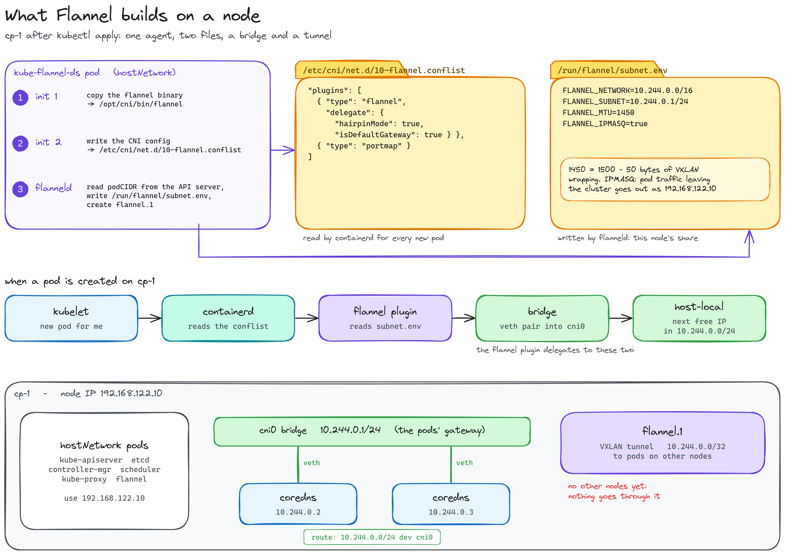
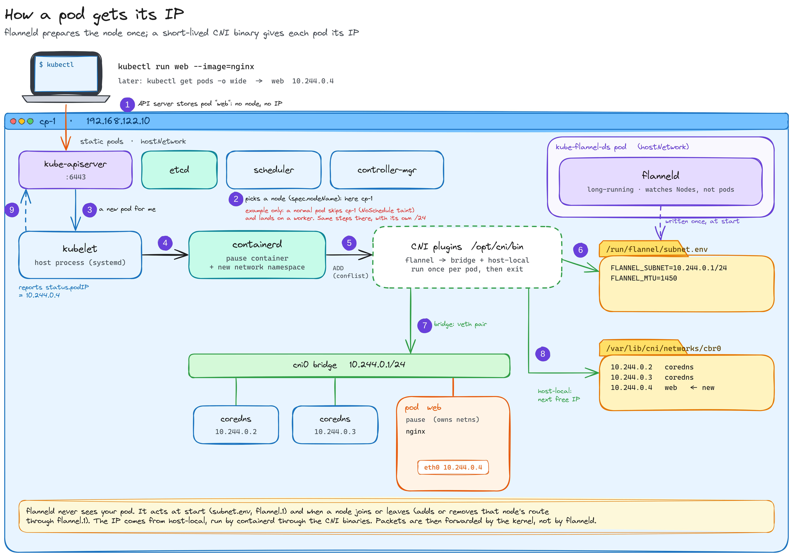
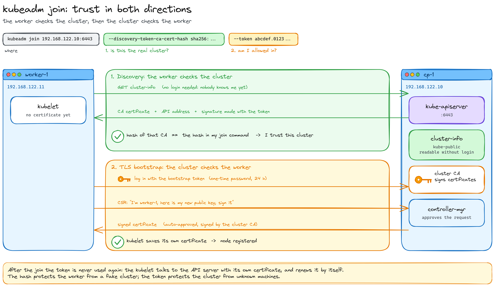
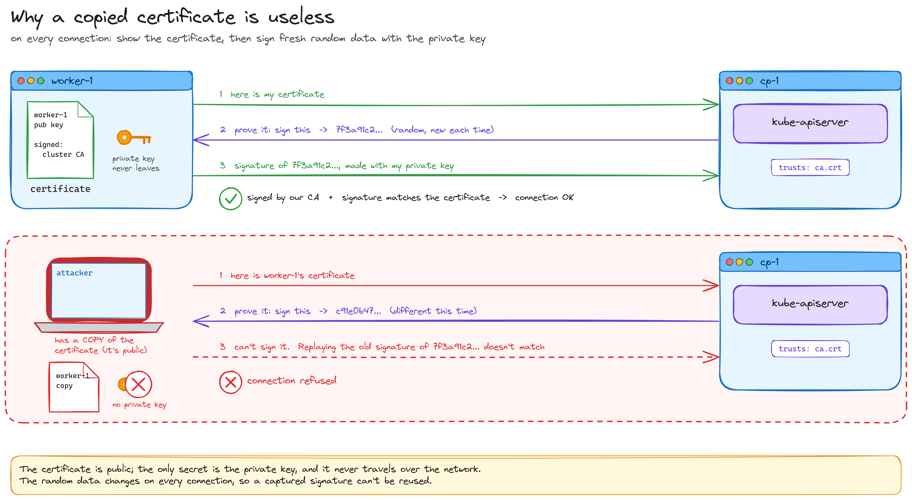
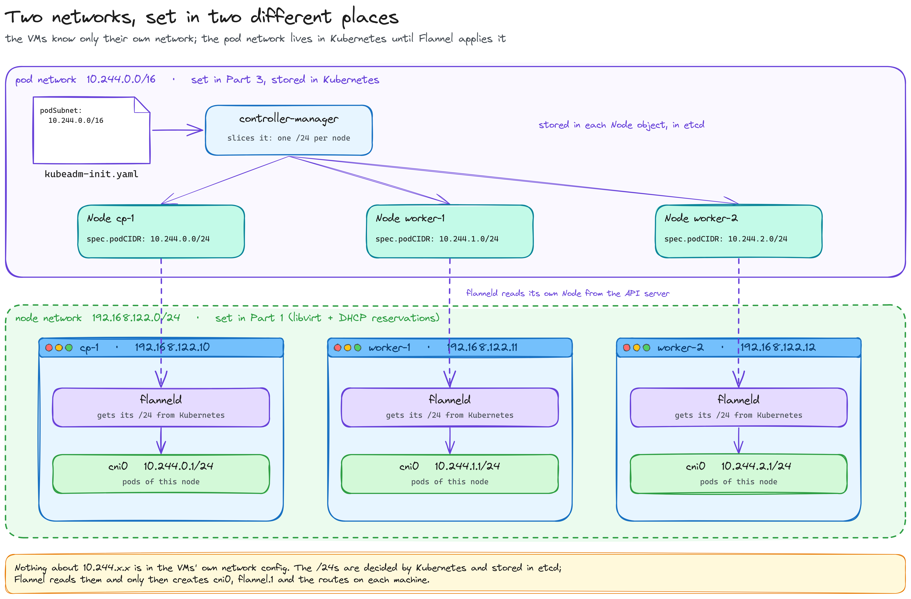
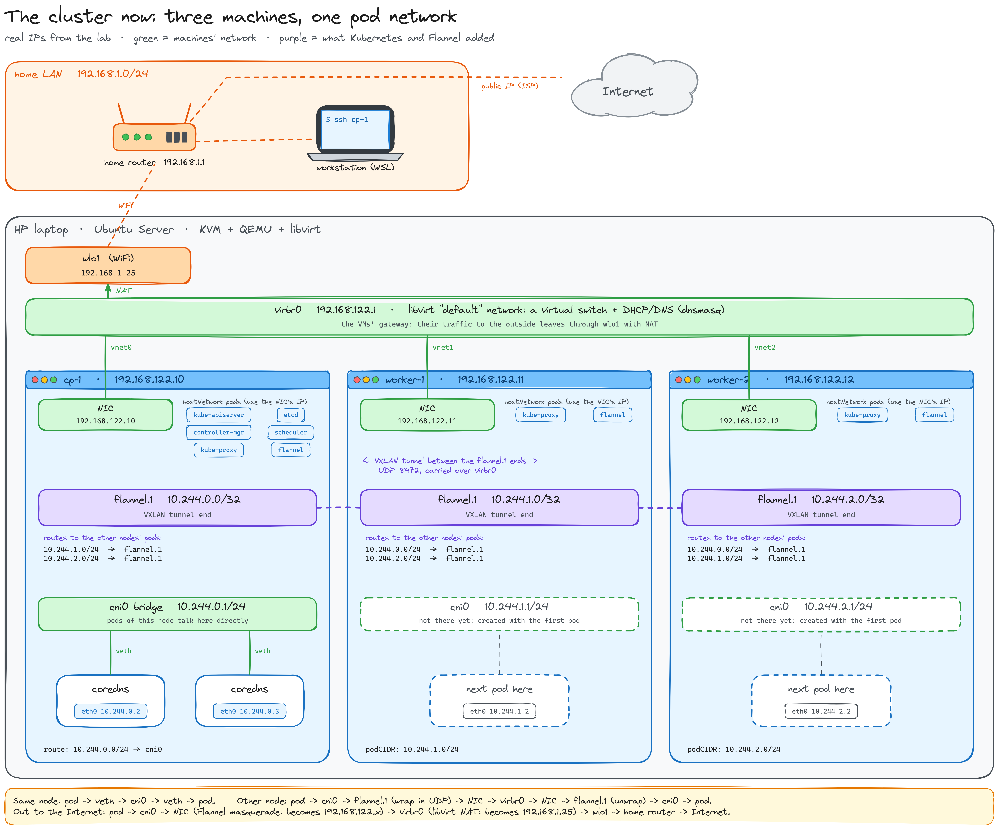

# Part 4 — Pod network and workers

*Flannel, `kubeadm join`, and a first app spread across three nodes*

[← Part 3: the control plane](../part-3-cluster/README.md) · [Index](../../README.md)

> **Status: in progress.** Written while building it: every output below is from my lab.

[Part 3](../part-3-cluster/README.md) left a control plane on `cp-1` with nowhere to put pods: the node is `NotReady` and CoreDNS is `Pending`, because there is no pod network yet. In this part the three nodes become one cluster.

The plan:

1. Install the pod network (Flannel)
2. Join the workers
3. Smoke test

---

## 1. Install the pod network (Flannel)

> **Run on:** `cp-1` only. Flannel is installed **through the API server**, and its DaemonSet puts a copy on every node by itself, including the workers that join later.

### Why Flannel

A CNI plugin has one job: give every pod an IP and make that IP reachable from every other pod, on any node. There are many; these are the three you meet everywhere:

| | Flannel | Calico | Cilium |
|---|---|---|---|
| How pods on different nodes talk | VXLAN overlay: pod packets wrapped in UDP between nodes | routing (BGP) or an overlay | eBPF in the kernel, overlay or routing |
| What runs on each node | one small agent (DaemonSet) | an agent, plus an operator | an agent, plus an operator; can replace kube-proxy |
| NetworkPolicy | **no** | yes | yes, also L7 |
| Weight | the lightest | medium | the heaviest |
| Moving parts to learn | few | more (BGP, IPAM pools) | many (eBPF, its own tooling) |

Flannel for this lab, because:

- **RAM.** The whole cluster lives in 5.7 GB and `cp-1` has 1.75 GB. Flannel is one small process per node; Cilium's agent alone would take a noticeable share of a worker.
- **It works on any network.** VXLAN only needs the nodes to reach each other over UDP, which they already do on `192.168.122.0/24`. No BGP, no router to configure.
- **Its default range is our `podSubnet`.** `10.244.0.0/16` is Flannel's default, and the one we put in `kubeadm-init.yaml` in Part 3.
- **Few moving parts.** The goal of this part is to see the pod network working end to end. With Flannel there's little in between: a bridge, a route per node, and a tunnel interface.

> **The trade-off: no NetworkPolicies.** Flannel connects pods but doesn't filter traffic between them. You can create a `NetworkPolicy` object and the API server accepts it, but nothing enforces it. When a later part needs policies, that's the moment for Calico or Cilium.

### 1.1 Before: what Flannel will build on

```bash
kubectl get node cp-1 -o jsonpath='{.spec.podCIDR}{"\n"}'
sudo ls /etc/cni/net.d/
ls /opt/cni/bin/
```

```
10.244.0.0/24

LICENSE  README.md  bandwidth  bridge  dhcp  dummy  firewall  host-device  host-local  ipvlan  loopback  macvlan  portmap  ptp  sbr  static  tap  tuning  vlan  vrf
```

(`/etc/cni/net.d/` needs `sudo`: only root can read it. Without it: `Permission denied`. The empty line is its output: nothing there yet.)

- **`podCIDR`**: because `kubeadm-init.yaml` has a `podSubnet`, the controller-manager runs with `--allocate-node-cidrs` and slices the `/16` into one **`/24` per node**. Flannel doesn't hand out IPs itself: each node reads its own `podCIDR`.
- **`/etc/cni/net.d/` is empty.** This is exactly why the node is `NotReady`: containerd looks here for a network config and finds none (`NetworkReady: false` since Part 2).
- **`/opt/cni/bin/`** has the base plugins, installed with the Kubernetes packages in Part 2. Each one is a small binary that does one job when a pod is created. The ones Flannel will use:

| Plugin | Job |
|---|---|
| `bridge` | creates the `cni0` bridge on the node and plugs each pod into it with a veth pair |
| `host-local` | the IPAM: picks a free IP from the node's `/24` and remembers it on disk |
| `portmap` | `hostPort`: maps a port on the node to a port in the pod |
| `loopback` | brings up `lo` inside every pod |

There's no `flannel` binary yet: Flannel brings its own and copies it here when it starts.

### 1.2 Read the manifest before applying it

`kubectl apply -f <url>` would work straight away, but downloading it first lets you check what you're about to install.

```bash
curl -LO https://github.com/flannel-io/flannel/releases/latest/download/kube-flannel.yml
grep -A7 'net-conf.json' kube-flannel.yml
```

```
  net-conf.json: |
    {
      "Network": "10.244.0.0/16",
      "EnableNFTables": false,
      "Backend": {
        "Type": "vxlan"
      }
    }
```

- **`"Network": "10.244.0.0/16"`**: the same as our `podSubnet`. If they differed, Flannel would route one range while the nodes' `podCIDR`s came from another, and pods would get IPs nobody can reach.
- **`"Type": "vxlan"`**: the overlay. A packet from a pod on one node to a pod on another is wrapped in a UDP packet between the two nodes' real IPs ([how the VXLAN tunnel works](../deep-dives/vxlan/README.md)).
- **`"EnableNFTables": false`**: Flannel writes its few firewall rules (NAT for pod traffic leaving the cluster) with iptables, the same as kube-proxy does by default.

What the file creates:

```bash
grep '^kind:' kube-flannel.yml
```

```
kind: Namespace
kind: ServiceAccount
kind: ClusterRole
kind: ClusterRoleBinding
kind: ConfigMap
kind: DaemonSet
```

| Object | Why Flannel needs it |
|---|---|
| `Namespace` `kube-flannel` | its own namespace, labelled to allow privileged pods (it needs to create network interfaces on the node) |
| `ServiceAccount` `flannel` | the identity its pods use to call the API server |
| `ClusterRole` + `ClusterRoleBinding` | what that identity may do: read every node (to learn each one's `podCIDR` and real IP) and annotate its own node (so the others know how to reach it) |
| `ConfigMap` `kube-flannel-cfg` | the two configs: `net-conf.json` (above) and `cni-conf.json`, the CNI config each node will get |
| `DaemonSet` `kube-flannel-ds` | one Flannel pod per node, now and on every node that joins later |

Flannel's pods talk to the API server like everyone else (Part 3's hub and spoke): there's no separate Flannel database.

### 1.3 Apply it

```bash
kubectl apply -f kube-flannel.yml
kubectl get pods -n kube-flannel -o wide -w     # -w watches live; Ctrl+C to stop
```

```
namespace/kube-flannel created
serviceaccount/flannel created
clusterrole.rbac.authorization.k8s.io/flannel created
clusterrolebinding.rbac.authorization.k8s.io/flannel created
configmap/kube-flannel-cfg created
daemonset.apps/kube-flannel-ds created

NAME                    READY   STATUS            RESTARTS   AGE   IP               NODE
kube-flannel-ds-6rpx2   0/1     Init:0/2          0          0s    192.168.122.10   cp-1
kube-flannel-ds-6rpx2   0/1     Init:1/2          0          5s    192.168.122.10   cp-1
kube-flannel-ds-6rpx2   0/1     PodInitializing   0          15s   192.168.122.10   cp-1
kube-flannel-ds-6rpx2   1/1     Running           0          16s   192.168.122.10   cp-1
```

- **One line per object** in the file, all created through the API server.
- **One Flannel pod**, because the DaemonSet puts one on every node and there's only one node so far. When the workers join, each gets its own without doing anything.
- **`Init:0/2` → `Init:1/2`**: two **init containers** run first, one after the other, and must finish before the main one starts. The first copies the `flannel` binary into `/opt/cni/bin/`; the second writes `cni-conf.json` as `/etc/cni/net.d/10-flannel.conflist`. Then `PodInitializing` → `Running`: `flanneld` itself, the agent that sets up the tunnel and the routes.
- **Its IP is `192.168.122.10`**: Flannel runs with `hostNetwork`, like the control plane. Same chicken-and-egg: it builds the pod network, so it can't depend on it.

Sixteen seconds later, the pods that were waiting:

```bash
kubectl get pods -n kube-system -o wide
```

```
NAME                           READY   STATUS    RESTARTS   AGE     IP               NODE
coredns-66bc5c9577-gr4bb       1/1     Running   0          6h31m   10.244.0.3       cp-1
coredns-66bc5c9577-pth78       1/1     Running   0          6h31m   10.244.0.2       cp-1
etcd-cp-1                      1/1     Running   0          6h31m   192.168.122.10   cp-1
kube-apiserver-cp-1            1/1     Running   0          6h31m   192.168.122.10   cp-1
kube-controller-manager-cp-1   1/1     Running   0          6h31m   192.168.122.10   cp-1
kube-proxy-z22dj               1/1     Running   0          6h31m   192.168.122.10   cp-1
kube-scheduler-cp-1            1/1     Running   0          6h31m   192.168.122.10   cp-1
```

- **CoreDNS is `Running`, with the first pod IPs of the cluster: `10.244.0.2` and `10.244.0.3`.** Both inside `cp-1`'s `10.244.0.0/24`. Everything else still shows `192.168.122.10`: they're `hostNetwork`.
- **Same names, `AGE 6h31m`**: these are the **same two pods** that were `Pending` since `init`. Nothing recreated them. As soon as the node went `Ready`, the `not-ready` taint was removed, the scheduler placed them on `cp-1` (CoreDNS tolerates the control-plane taint) and the kubelet started them, now with a network.
- **Why `.2` and not `.1`?** `10.244.0.1` belongs to the node itself, on the `cni0` bridge: it's the pods' gateway. `host-local` hands out IPs from `.2` up.

```bash
kubectl get nodes
```

```
NAME   STATUS   ROLES           AGE     VERSION
cp-1   Ready    control-plane   6h33m   v1.34.12
```

**`Ready`.** The kubelet found a network config, containerd reports `NetworkReady: true`, and the `not-ready` taint is gone.

Flannel also leaves its own mark on the node:

```bash
kubectl describe node cp-1 | grep NetworkUnavailable
```

```
NetworkUnavailable   False   Sat, 24 Oct 2026 21:15:26 +0000   Sat, 24 Oct 2026 21:15:26 +0000   FlannelIsUp   Flannel is running on this node
```

A double negative: **`NetworkUnavailable: False`** means the network **is** available. This node condition isn't set by the kubelet: **Flannel writes it** (reason `FlannelIsUp`) when it starts, through the API server. That's one of the things its `ClusterRole` allows. The timestamp is the moment the Flannel pod came up.

### 1.4 What Flannel built on the node

> **Run on:** `cp-1`. Every node that joins later gets the same, with its own `/24`.



The two files the init containers left:

```bash
sudo ls /etc/cni/net.d/              # 10-flannel.conflist
ls /opt/cni/bin/ | grep flannel      # flannel
```

**The CNI config**, what containerd reads every time it creates a pod:

```bash
sudo cat /etc/cni/net.d/10-flannel.conflist
```

```json
{
  "name": "cbr0",
  "cniVersion": "1.0.0",
  "plugins": [
    {
      "type": "flannel",
      "delegate": {
        "hairpinMode": true,
        "isDefaultGateway": true
      }
    },
    {
      "type": "portmap",
      "capabilities": {
        "portMappings": true
      }
    }
  ]
}
```

- **`plugins`** is a chain: containerd runs each binary from `/opt/cni/bin/` in order, `flannel` then `portmap`.
- **`"type": "flannel"`** doesn't build anything itself. It reads the node's settings (below) and **delegates** to the `bridge` plugin with `host-local` for IPs: the base plugins from Part 2 do the actual work.
- **`isDefaultGateway`**: every pod's default route points at the bridge, `10.244.0.1`.
- **`hairpinMode`**: a pod can reach **itself through a Service IP**. The packet leaves through its veth, kube-proxy's rules send it back to the same pod, and the bridge has to let it return through the port it came from. Without it, that rare case silently fails.
- **`portmap`** comes second, for pods that ask for a `hostPort`.
- `"name": "cbr0"` is just a historical label; the bridge itself is called `cni0`.

**This node's share**, written by `flanneld` from the node's `podCIDR`:

```bash
cat /run/flannel/subnet.env
```

```
FLANNEL_NETWORK=10.244.0.0/16
FLANNEL_SUBNET=10.244.0.1/24
FLANNEL_MTU=1450
FLANNEL_IPMASQ=true
```

| Line | Means |
|---|---|
| `FLANNEL_NETWORK` | the whole pod network, every node |
| `FLANNEL_SUBNET` | **this** node's `/24`, written as the gateway's address: `10.244.0.1` |
| `FLANNEL_MTU=1450` | 1500 (the VM network) minus **50 bytes** of VXLAN wrapping (outer IP, UDP and VXLAN headers plus the inner Ethernet header). Pods use smaller packets so the wrapped ones still fit |
| `FLANNEL_IPMASQ=true` | traffic from a pod to anything **outside** `10.244.0.0/16` (the Internet, the host) leaves with the node's IP. Pod IPs only mean something inside the cluster |

**The interfaces and the route:**

```bash
ip -br addr show | grep -E 'cni0|flannel'
ip route | grep 10.244
```

```
flannel.1        UNKNOWN        10.244.0.0/32 fe80::70a2:32ff:feb8:5374/64
cni0             UP             10.244.0.1/24 fe80::2c89:9eff:fe26:d259/64

10.244.0.0/24 dev cni0 proto kernel scope link src 10.244.0.1
```

- **`cni0`**: a Linux bridge, a virtual switch inside the node. Each pod is plugged into it with a **veth pair**, a virtual cable with one end inside the pod and the other on the bridge. Its `10.244.0.1` is the pods' gateway, which is why CoreDNS got `.2` and `.3`.
- **`flannel.1`**: the [**VXLAN tunnel**](../deep-dives/vxlan/README.md). Packets for pods on other nodes go in here, get wrapped in UDP, and travel to the other node's `192.168.122.x`. `UNKNOWN` is normal for a virtual device like this one, not an error.
- **One route**, `10.244.0.0/24 dev cni0`: pods on this node, through the bridge. There's no route to any other `/24` yet, because there are no other nodes. When a worker joins, `flanneld` adds `10.244.1.0/24 via flannel.1`, and `flannel.1` starts carrying traffic.


### 1.5 How a pod gets its IP, and when Flannel acts

It's easy to picture Flannel "giving" each pod its IP. It doesn't: **two different things** are at work, on two different timescales.



**Per pod: a short-lived binary.** Every time a pod lands on a node:

| # | Who | What |
|---|---|---|
| 1 | API server | stores the new pod: no node, no IP yet |
| 2 | scheduler | picks a node and writes it in `spec.nodeName` |
| 3 | kubelet on that node | sees a pod assigned to it |
| 4 | containerd | creates the `pause` container and a **new network namespace**: the pod's own, empty network stack |
| 5 | containerd | reads `10-flannel.conflist` and runs `/opt/cni/bin/flannel` with the command `ADD` |
| 6 | `flannel` binary | reads `/run/flannel/subnet.env` (this node's `/24`, MTU) and hands the work to `bridge` |
| 7 | `bridge` | creates a **veth pair**: one end becomes `eth0` inside the pod, the other is plugged into `cni0`. Sets the default route via `10.244.0.1` |
| 8 | `host-local` | picks the next free IP in the node's `/24` and records it as a file in `/var/lib/cni/networks/cbr0/` |
| 9 | kubelet | reports the IP to the API server (`status.podIP`): now `kubectl get pods -o wide` shows it |

The binaries exit as soon as they finish. When the pod is deleted, containerd runs the same chain with `DEL`: the veth disappears and `host-local` frees the IP.

In step 4, the [`pause` container](../deep-dives/pods-and-pause/README.md) is a tiny container that holds the pod's network, so the IP survives when the app container restarts.

**Per node: `flanneld`, always running.** It never hears about pods. It acts:

| When | What it does |
|---|---|
| it starts | reads its node's `podCIDR`, writes `subnet.env`, creates `flannel.1`, marks the node `NetworkUnavailable: False` |
| another node joins | adds a route to that node's `/24` **through `flannel.1`**, plus what the tunnel needs to know that node's real IP |
| a node leaves | removes them |

Once the routes exist, **the kernel forwards every packet** (bridge, routes, VXLAN). `flanneld` isn't in the data path: if it stopped, existing pods would keep talking; only changes (new nodes) would stop being applied.

> In the diagram the example pod lands on `cp-1` to keep everything in one picture. A normal pod wouldn't: the control-plane `NoSchedule` taint sends it to a worker, where the same steps happen with that node's own `/24`.


---

## 2. Join the workers

The workers already have everything from Part 2 (containerd, kubelet, kubeadm) and a kubelet crash-looping, waiting for a config. `kubeadm join` gives it one.

It's one command, but it solves a **trust problem in both directions**. The worker has to be sure it's joining the real cluster and not an impostor. The cluster has to be sure the machine knocking is allowed in. The join command carries one piece for each:

```
kubeadm join 192.168.122.10:6443  --discovery-token-ca-cert-hash sha256:…  --token abcdef.…
             └── where ────────┘  └── 1. is this the real cluster? ───────┘  └── 2. am I allowed in? ┘
```



**1. Discovery: the worker checks the cluster.**

1. When `init` ran, `cp-1` computed the **hash of its CA certificate** and printed it in the join command.
2. You copy that command onto the worker. That copy-paste is the trusted channel: the two machines have never talked before.
3. The worker knocks on `192.168.122.10:6443` and downloads `cluster-info`, the only thing the API server serves without login. It contains the CA certificate (`ca.crt`, which is public).
4. The worker hashes that certificate itself and compares the result with the hash you gave it.
5. If they match, it's the real `cp-1`. An impostor would have a different CA, so a different hash.

> **A hash is not a signature.** It's a fingerprint: no key involved, anyone can compute it, the same input always gives the same result. That's all the worker needs to recognise the right CA. (This check is called **CA pinning**.)

**2. TLS bootstrap: the cluster checks the worker.**

1. The worker generates a **key pair**. The private key never leaves `worker-1`.
2. It fills in a **CSR** (*Certificate Signing Request*). It's not a channel or an encryption, just a form: *"I'm `worker-1`, here's my public key, please sign it"*.
3. It sends the CSR to the API server, logged in with the **bootstrap token**: the token is what says *"I was invited"*.
4. The controller-manager approves it automatically (valid token), and the CA signs it with `ca.key`. The result is the worker's **certificate**: its name, its public key, and the CA's signature.
5. The worker stores it, and registers as a node.

**After the join: mTLS.** From now on, every time the kubelet **opens a connection** to the API server, both sides prove who they are. There are two different signatures involved:

| Signature | Made by | When | What it proves |
|---|---|---|---|
| inside the certificate | the CA, with `ca.key` | **once**, when the certificate is issued | "the CA vouches that this public key belongs to `worker-1`". It's public: anyone can see and copy the certificate |
| in the handshake | the owner, with **its own private key** | on **every new connection**, over fresh random data | "I'm the real owner of this certificate, not someone who copied it" |

Each side checks both: the other's certificate is signed by the cluster CA, **and** the other just signed the fresh data with the matching private key.

- **Someone who copied `worker-1`'s certificate** can show it, but can't produce the handshake signature without the private key: connection refused.
- **Someone who captured an old handshake** can't replay it: the random data is different on every connection.
- So the only real secret is **the private key**, and it never travels over the network. (If it were stolen, the thief *could* pass as `worker-1`; that's why private keys are readable by root only, and `ca.key` never leaves `cp-1`.)



Once the handshake is done, both sides agree on temporary keys and every request on that connection travels encrypted, without signing again. The kubelet keeps its connection open, so handshakes are rare. The token is never used again, which is why it can expire after 24 hours.

> In short: **the hash protects the worker from a fake cluster; the token protects the cluster from unknown machines.**

### 2.1 A fresh join command

> **Run on:** `cp-1`.

The token printed by `kubeadm init` lasts 24 hours. Mine had expired by the time I got here, so:

```bash
sudo kubeadm token list                          # nothing: the expired one was already cleaned up
sudo kubeadm token create --print-join-command
```

```
kubeadm join 192.168.122.10:6443 --token <redacted> --discovery-token-ca-cert-hash sha256:<redacted>
```

- **`token list` prints nothing**: the controller-manager's *tokencleaner* deleted the expired token.
- **The token has two halves**, `<id>.<secret>`. The id is public (it appears in names, as you'll see next); the secret is the password.

**See step 1 for yourself.** The hash in the join command is nothing secret: you can compute it from `cp-1`'s CA certificate, and so can the worker.

```bash
openssl x509 -pubkey -in /etc/kubernetes/pki/ca.crt \
  | openssl rsa -pubin -outform der 2>/dev/null \
  | openssl dgst -sha256 -hex | sed 's/^.* //'
```

```
cbd2c9fb06879e54…          ← exactly the value after sha256: in the join command
```

Take the CA's public key, convert it to binary (DER), compute its SHA-256. No private key anywhere: it's a fingerprint, not a signature.

`--print-join-command` creates a new token (valid 24 h) and prints the whole `kubeadm join` line. The `--discovery-token-ca-cert-hash` is the same as in Part 3: it's the hash of `cp-1`'s CA, which hasn't changed. As always, that line **never goes in the repo**.

### 2.2 Before: what the worker looks like

> **Run on:** `worker-1`.

First, what the worker can see **before** it has any credentials:

```bash
curl -sk https://192.168.122.10:6443/api/v1/namespaces/kube-public/configmaps/cluster-info \
  | grep -oE '"(kubeconfig|jws-kubeconfig-[a-z0-9]+)"'
```

```
"jws-kubeconfig-p9jtho"
"kubeconfig"
```

- An anonymous request (no certificate, no token), and the API server answers: `cluster-info` is the one object anyone may read.
- **`kubeconfig`** holds the CA certificate and the API server address: what the worker hashes in step 1.
- **`jws-kubeconfig-<token id>`** is a signature over it made with the bootstrap token. The token id appears in the name; the secret half never does.
- (`-k` skips checking the API server's certificate: right now the worker has no CA to check it with. That's exactly the gap the hash closes.)

Then the node itself:

```bash
sudo apt install -y tree        # not installed on the workers
sudo tree /etc/kubernetes /var/lib/kubelet
sudo crictl ps -a
systemctl show kubelet -p SubState -p NRestarts
```

```
/etc/kubernetes
└── manifests
/var/lib/kubelet

2 directories, 0 files

CONTAINER   IMAGE   CREATED   STATE   NAME   ATTEMPT   POD ID   POD   NAMESPACE

NRestarts=8909
SubState=auto-restart
```

- **Empty folders**: the same as `cp-1` before `init` (Part 3). No kubeconfig, no certificates, no kubelet config.

- **No containers at all**: not even Flannel. A machine that isn't a node gets nothing from a DaemonSet.
- **`NRestarts=8909`, `auto-restart`**: the kubelet crash-loop from Part 2, still going. It starts, finds no `config.yaml`, exits, and systemd brings it back 10 seconds later. `join` is what ends it, exactly like `init` did on `cp-1`.

### 2.3 Join

> **Run on:** `worker-1` (then the same on `worker-2`), with a second terminal on `cp-1` watching.

On `cp-1`, to watch the node arrive:

```bash
kubectl get nodes -w
```

On `worker-1`, the command printed in 2.1:

```bash
sudo kubeadm join 192.168.122.10:6443 --token <redacted> \
  --discovery-token-ca-cert-hash sha256:<redacted>
```

```
[preflight] Running pre-flight checks
[preflight] Reading configuration from the "kubeadm-config" ConfigMap in namespace "kube-system"...
W1026 19:14:01.327255   71011 utils.go:69] The recommended value for "bindAddress" in "KubeProxyConfiguration" is: ::; the provided value is: 0.0.0.0
[kubelet-start] Writing kubelet configuration to file "/var/lib/kubelet/instance-config.yaml"
[patches] Applied patch of type "application/strategic-merge-patch+json" to target "kubeletconfiguration"
[kubelet-start] Writing kubelet configuration to file "/var/lib/kubelet/config.yaml"
[kubelet-start] Writing kubelet environment file with flags to file "/var/lib/kubelet/kubeadm-flags.env"
[kubelet-start] Starting the kubelet
[kubelet-check] The kubelet is healthy after 507.926852ms
[kubelet-start] Waiting for the kubelet to perform the TLS Bootstrap

This node has joined the cluster:
* Certificate signing request was sent to apiserver and a response was received.
* The Kubelet was informed of the new secure connection details.
```

Much shorter than `init`: no certificates to create, no static pods, no addons. The order matters: **kubeadm** checks the cluster first (step 1), prepares and starts the kubelet, and then **the kubelet** introduces itself (step 2). It's the kubelet that will talk to the API server from now on, so it's the one that needs the certificate. Phase by phase:

| Phase | What happened |
|---|---|
| (silent) discovery | **kubeadm** does step 1 of the picture: download `cluster-info`, check the CA hash. Only printed with `-v=5` |
| `preflight` | the same checks as on `cp-1`, then it reads the `kubeadm-config` ConfigMap that `init` uploaded (Part 3): that's how the worker learns the cluster's settings without a config file of its own |
| warning `bindAddress` | harmless: kube-proxy's settings say `0.0.0.0` (IPv4), and kubeadm suggests `::` for clusters that also use IPv6. This one doesn't |
| `kubelet-start` | writes `config.yaml` (shared by every node) plus `instance-config.yaml` (this node's own values, merged in as a patch) and `kubeadm-flags.env`, then starts the kubelet: **the 8909-restart crash-loop ends here** |
| `kubelet-check` | the kubelet answers on its local health port, `127.0.0.1:10248`, in half a second |
| TLS bootstrap | step 2 of the picture, done by the **kubelet** itself, now that it's running: it logs in with the token (from a temporary `bootstrap-kubelet.conf`), sends the CSR, gets its certificate back and writes `kubelet.conf`. kubeadm just waits for it |

Meanwhile, on `cp-1`:

```
NAME       STATUS     ROLES           AGE    VERSION
cp-1       Ready      control-plane   2d4h   v1.34.12
worker-1   NotReady   <none>          0s     v1.34.12
worker-1   NotReady   <none>          10s    v1.34.12
worker-1   Ready      <none>          15s    v1.34.12
```

- **`NotReady` at `0s`**: as soon as the kubelet has its certificate, it registers the `Node` object.
- **`Ready` 15 seconds later**: the time for the DaemonSet to start a Flannel pod on `worker-1` and write its CNI config. Nothing to install by hand.
- **`ROLES <none>`**: only the control plane gets a role label. A worker is simply a node without one.

### 2.4 After: what the join changed

> **Run on:** `cp-1`.

```bash
kubectl get nodes -o wide
```

```
NAME       STATUS   ROLES           AGE    VERSION    INTERNAL-IP      OS-IMAGE             KERNEL-VERSION      CONTAINER-RUNTIME
cp-1       Ready    control-plane   2d4h   v1.34.12   192.168.122.10   Ubuntu 24.04.5 LTS   6.8.0-147-generic   containerd://2.4.2
worker-1   Ready    <none>          114s   v1.34.12   192.168.122.11   Ubuntu 24.04.5 LTS   6.8.0-147-generic   containerd://2.4.2
```

**`INTERNAL-IP 192.168.122.11`**: the worker's real address, found on its own. The VMs have a single network interface, so no `node-ip` setting was needed for the join (on `cp-1` we set it in the config file to be explicit).

**The form from step 2**, as the cluster saw it:

```bash
kubectl get csr
```

```
NAME        AGE    SIGNERNAME                                    REQUESTOR                 CONDITION
csr-whzzf   114s   kubernetes.io/kube-apiserver-client-kubelet   system:bootstrap:p9jtho   Approved,Issued
```

- **`REQUESTOR system:bootstrap:<token id>`**: whoever sent it logged in **with the bootstrap token**. That's the identity a token gives you, and the only one the auto-approval trusts.
- **`SIGNERNAME …kube-apiserver-client-kubelet`**: what kind of certificate it asked for: a client certificate for a kubelet talking to the API server.
- **`Approved,Issued`**: the controller-manager approved it and the CA signed it.

**What the DaemonSets did on their own:**

```bash
kubectl get pods -A -o wide | grep worker-1
```

```
kube-flannel   kube-flannel-ds-5v8pk   1/1   Running   0   114s   192.168.122.11   worker-1
kube-system    kube-proxy-pn5lz        1/1   Running   0   114s   192.168.122.11   worker-1
```

Flannel and kube-proxy, both born with the node (`114s`) and both on `hostNetwork` (the node's IP). Nobody asked for them: a DaemonSet means "one on every node".

```bash
kubectl get daemonset -n kube-flannel
```

```
NAME              DESIRED   CURRENT   READY   UP-TO-DATE   AVAILABLE   NODE SELECTOR   AGE
kube-flannel-ds   2         2         2       2            2           <none>          46h
```

**`DESIRED 2`**: the DaemonSet counts the nodes (no `NODE SELECTOR`, so all of them) and wants one pod on each; **`READY 2`**: both are up. This is why `worker-1` went `Ready` on its own: the moment it registered, `DESIRED` became 2, the DaemonSet created the missing pod, and that pod wrote the CNI config the node was waiting for.

**The new node's share of the pod network, and the first route through the tunnel:**

```bash
kubectl get nodes -o jsonpath='{range .items[*]}{.metadata.name}{"\t"}{.spec.podCIDR}{"\n"}{end}'
ip route | grep 10.244
```

```
cp-1        10.244.0.0/24
worker-1    10.244.1.0/24

10.244.0.0/24 dev cni0 proto kernel scope link src 10.244.0.1
10.244.1.0/24 via 10.244.1.0 dev flannel.1 onlink
```

- **One `/24` per node**: the controller-manager gave `worker-1` the next one, `10.244.1.0/24`. (`range … end` loops over every node and prints name and `podCIDR`.)
- **The new route** is what `flanneld` on `cp-1` added the moment it saw the new node: *"to reach `worker-1`'s pods, go through `flannel.1`"*. `via 10.244.1.0` is the address of `worker-1`'s own `flannel.1`; `onlink` tells the kernel to treat it as directly reachable through the tunnel. Under the hood, `flannel.1` wraps those packets in UDP and sends them to `192.168.122.11`.

**Where those `/24`s come from.** Not from the VMs: they only know their own network, set up in Part 1. The pod network was set in Part 3 and lives in Kubernetes:



1. `podSubnet: 10.244.0.0/16` in `kubeadm-init.yaml` told the controller-manager which range to use.
2. When a node registers, the controller-manager gives it the next free `/24` and writes it in the `Node` object (`spec.podCIDR`), in etcd.
3. The node's `flanneld` reads its own `podCIDR` from the API server, and only then configures the machine: `subnet.env`, `cni0`, `flannel.1`, the routes.

That's why Flannel's `Network` had to match `podSubnet` (1.2), and why nothing about `10.244.x.x` appears in the VMs' own network config.

> **Run on:** `worker-1`.

```bash
tree /etc/kubernetes
```

```
/etc/kubernetes
├── kubelet.conf
├── manifests
└── pki
    └── ca.crt

3 directories, 2 files
```

Two files, against 31 on `cp-1` (Part 3):

| File | What it is |
|---|---|
| `kubelet.conf` | the kubelet's kubeconfig: the API server address (`192.168.122.10:6443`) and **where its certificate is** (`/var/lib/kubelet/pki/`) |
| `pki/ca.crt` | the cluster CA's **public** certificate, the one the worker checked against the hash. With it the kubelet verifies the API server on every connection. No `ca.key`: a worker can't sign anything |
| `manifests/` | empty: no static pods, a worker runs no control plane |

What's inside `kubelet.conf`:

```bash
sudo cat /etc/kubernetes/kubelet.conf
```

```yaml
clusters:
- cluster:
    certificate-authority-data: LS0tLS1CRUdJTiBDRVJUSUZJQ0FURS0tLS0t…   # base64 of ca.crt
    server: https://192.168.122.10:6443
users:
- name: default-auth
  user:
    client-certificate: /var/lib/kubelet/pki/kubelet-client-current.pem
    client-key: /var/lib/kubelet/pki/kubelet-client-current.pem
```

| Field | Used for |
|---|---|
| `server` | where the API server is |
| `certificate-authority-data` | the CA's **public** certificate (base64: it decodes to `-----BEGIN CERTIFICATE-----…`). Used to **verify** the API server: its certificate must be signed by this CA. The CA signs with `ca.key`, which stays on `cp-1` |
| `client-certificate` | the certificate from step 2: the kubelet's public key and name, **signed by the CA**. Shown on every connection |
| `client-key` | the kubelet's **private key**, generated on the worker. Used to sign the fresh data in each handshake. Both live in the same `.pem` file |

The name the kubelet logs in with isn't in this file: it's inside the certificate (`CN=system:node:worker-1`, group `system:nodes`).

Side by side with `cp-1`:

| In `/etc/kubernetes` | `cp-1` (control plane) | `worker-1` |
|---|---|---|
| kubeconfigs | 5: `admin`, `super-admin`, `kubelet`, `controller-manager`, `scheduler` | 1: `kubelet.conf` |
| `pki/` | 22 files: 3 CAs **with their private keys**, every server and client certificate, `sa.key`/`sa.pub` | 1 file: `ca.crt`, public |
| `manifests/` | 4 static pods: etcd, API server, controller-manager, scheduler | empty |

A worker holds no secrets of the cluster: nothing to sign with, no admin access, no database. Losing a worker is losing a node; losing `cp-1`'s `pki/` is losing the cluster.

The temporary `bootstrap-kubelet.conf` (the one holding the token) is already gone: kubeadm deletes it once the kubelet has its own certificate.

And `/var/lib/kubelet`, trimmed to the parts that matter:

```bash
sudo tree /var/lib/kubelet
```

```
/var/lib/kubelet
├── config.yaml                  ← written by join
├── instance-config.yaml         ← written by join
├── kubeadm-flags.env            ← written by join
├── pki
│   ├── kubelet-client-2026-10-26-19-14-02.pem
│   ├── kubelet-client-current.pem -> kubelet-client-2026-10-26-19-14-02.pem
│   ├── kubelet.crt
│   └── kubelet.key
└── pods
    ├── 0639b97f-…               ← the Flannel pod
    │   ├── containers/  install-cni  install-cni-plugin  kube-flannel
    │   └── volumes/
    │       ├── kubernetes.io~configmap/flannel-cfg/   cni-conf.json  net-conf.json
    │       └── kubernetes.io~projected/kube-api-access-…/   ca.crt  namespace  token
    └── aadb3fc7-…               ← the kube-proxy pod
        └── …
(plus some internal state files: cpu_manager_state, memory_manager_state…)
```

- **`pki/kubelet-client-<date>.pem`**: **the certificate from step 2**, issued at the moment of the join (19:14:02 UTC), with its private key in the same file. `kubelet-client-current.pem` points to it, and that's the path `kubelet.conf` uses. When the certificate is renewed, a new dated file appears and the link moves.
- **`pki/kubelet.crt` / `kubelet.key`**: a different certificate, for the kubelet's own **server** on port `10250`: the API server connects there for `kubectl logs` and `kubectl exec`.
- **`pods/<uid>/`**: one folder per pod on this node. The Flannel one shows the **two init containers** we saw as `Init:0/2` in 1.3, the ConfigMap from the manifest mounted as files, and a **`token`**: the identity of the `flannel` ServiceAccount, signed with `cp-1`'s `sa.key` (Part 3). That's how Flannel's pod logs in to the API server.

The images the join brought, and nothing else:

```bash
sudo crictl images
```

```
IMAGE                                   TAG                 SIZE
ghcr.io/flannel-io/flannel-cni-plugin   v1.9.1-flannel3     5.17MB
ghcr.io/flannel-io/flannel              v0.28.10            35.6MB
registry.k8s.io/kube-proxy              v1.34.12            27.4MB
registry.k8s.io/pause                   3.10.1              320kB
```

Four images, about 70 MB: no etcd, no API server, no scheduler. That's all a node needs to run pods.

```bash
systemctl show kubelet -p SubState -p NRestarts
ip route | grep 10.244
```

```
NRestarts=8915
SubState=running

10.244.0.0/24 via 10.244.0.0 dev flannel.1 onlink
```

- **`running`, and `NRestarts` frozen at 8915**: the crash-loop is over.
- **The mirror route**: `worker-1` reaches `cp-1`'s pods (`10.244.0.0/24`) through its own `flannel.1`. Each node has a route to every other node's `/24`, and to nothing else.
- **No `10.244.1.0/24 dev cni0` yet**: `cni0` is created by the `bridge` plugin when the **first pod with its own IP** lands on the node. Flannel and kube-proxy use `hostNetwork`, so `worker-1` has no bridge until the smoke test puts a pod there. (On `cp-1` it appeared with CoreDNS.)


### 2.5 Checks from the control plane

> **Run on:** `cp-1`.

**How each node tells the others where it is.** Every `flanneld` writes a few annotations on its own `Node` object:

```bash
kubectl describe node worker-1 | grep -A6 Annotations
```

```
Annotations:  flannel.alpha.coreos.com/backend-data: {"VNI":1,"VtepMAC":"42:0f:8c:14:94:37"}
              flannel.alpha.coreos.com/backend-type: vxlan
              flannel.alpha.coreos.com/kube-subnet-manager: true
              flannel.alpha.coreos.com/public-ip: 192.168.122.11
```

| Annotation | Means |
|---|---|
| `public-ip` | the node's **real** IP: where tunnel packets for its pods must be sent |
| `backend-data` → `VtepMAC` | the MAC address of **its** `flannel.1` (the tunnel's end on that node) |
| `backend-data` → `VNI` | the VXLAN network number: every node uses `1`, so they're all in the same overlay |
| `kube-subnet-manager: true` | Flannel keeps its data in the Kubernetes API, not in a database of its own |

Every `flanneld` watches the `Node` objects, reads these annotations, and programs its own machine to reach the others. That's how `cp-1` got its route to `10.244.1.0/24` without anyone telling it.

**Taints:**

```bash
kubectl describe node worker-1 | grep Taints
```

```
Taints:             <none>
```

`cp-1` has `control-plane:NoSchedule`; the workers have nothing. So regular pods can land here, and only here.

**The third network: Services.**

```bash
kubectl get svc -A
```

```
NAMESPACE     NAME         TYPE        CLUSTER-IP   PORT(S)                  AGE
default       kubernetes   ClusterIP   10.96.0.1    443/TCP                  2d5h
kube-system   kube-dns     ClusterIP   10.96.0.10   53/UDP,53/TCP,9153/TCP   2d5h
```

- **`kubernetes`, `10.96.0.1:443`**: the API server as seen from inside the cluster. A pod that needs the API server (Flannel itself, for example) uses this address. It's the `10.96.0.1` that was in the API server's certificate (Part 3).
- **`kube-dns`, `10.96.0.10`**: CoreDNS. Port `53` for DNS, `9153` for its metrics. Every pod gets this address as its DNS server.
- Both come from `serviceSubnet: 10.96.0.0/12` (Part 3). These IPs belong to no interface anywhere: kube-proxy turns them into iptables rules on every node.

So the cluster has **three** ranges, each from a different place: nodes `192.168.122.0/24` (Part 1), pods `10.244.0.0/16` (Flannel), Services `10.96.0.0/12` (kube-proxy).


### 2.6 And `worker-2`

Exactly the same steps, with the same kind of join command (`kubeadm token create --print-join-command` on `cp-1`, `kubeadm join` on `worker-2`). Three nodes:

```bash
kubectl get nodes
```

```
NAME       STATUS   ROLES           AGE     VERSION
cp-1       Ready    control-plane   2d5h    v1.34.12
worker-1   Ready    <none>          66m     v1.34.12
worker-2   Ready    <none>          7m14s   v1.34.12
```

<!-- TODO: podCIDRs of the 3 nodes, routes, daemonset 3/3 -->

**Where we are.** Three machines on one virtual switch, and one pod network on top:



- **The machines' network** (green) is still the one from Part 1: each VM plugs into `virbr0`, libvirt's virtual switch on the host, which also hands out the IPs and does NAT to the outside. Flannel didn't add any bridge between the VMs.
- **The pod network** (purple) rides on top of it: each node has a `flannel.1` tunnel end and a route to every other node's `/24`. A pod packet for another node is wrapped in UDP and travels between the VMs' normal IPs, through `virbr0`, like any other traffic.
- **Inside a node**, pods talk through its `cni0` bridge. The workers don't have one yet: it appears with their first pod, in the smoke test.


---

## 3. Smoke test

> **Run on:** `cp-1` (the `kubectl` commands), plus the node where the pod lands.

Everything so far was checked from the outside. Now the real test: pods that get scheduled, get an IP, and talk to each other across nodes, by name.

*Coming next: one pod on a worker, then a Deployment spread across both workers behind a Service, reached by name.*

<!-- TODO: 3.1 one pod (where it lands, IP, cni0 appears, ping/curl across the tunnel, tcpdump) · 3.2 Deployment + Service + DNS · 3.3 clean up -->

---

## Questions I had along the way

**Why do both CoreDNS pods end up on `cp-1`?**
It was the only node when they got scheduled. Kubernetes doesn't move running pods to rebalance: they stay on `cp-1` even after the workers join. A `kubectl rollout restart deployment coredns -n kube-system` creates new ones, and the scheduler then spreads them.

**Why does Flannel's pod have the node's IP?**
`hostNetwork`, for the same chicken-and-egg reason as the control plane: it creates the pod network, so it can't live inside it.

**Does Flannel assign each pod its IP? When does it react?**
No. A CNI binary run by containerd does it, once per pod, using `host-local`. `flanneld` reacts to **nodes**: at start and when one joins or leaves. → [1.5](#15-how-a-pod-gets-its-ip-and-when-flannel-acts)

**What is the `pause` container for? Does traffic go through it?**
It's the anchor of the pod's **sandbox**: the network namespace with the pod's IP lives as long as the pod, not as long as one container, so a crashed container comes back with the same IP. No traffic goes through it. → [Deep dive](../deep-dives/pods-and-pause/README.md)

**Do I have to install Flannel again on each worker?**
No. `kubectl apply` runs once, from `cp-1`: it only creates objects in the API server. The DaemonSet then starts one Flannel pod on every node, and on every node that joins later. Each one writes that node's own `subnet.env` (its own `/24`), its own `10-flannel.conflist`, `cni0` and `flannel.1`.

**Is the CA hash a signature made with a private key?**
No. A hash is a **fingerprint**: no key involved, anyone can compute it, and the same input always gives the same result. The CA certificate is public; the hash is just its fingerprint, printed by `cp-1` in the join command. *You* carry it to the worker when you copy the command: that's the trusted channel. The worker downloads the certificate, computes the fingerprint itself and compares. The only private keys in the join are the worker's new key (step 2) and the CA's `ca.key`, which signs its certificate.

**Is the certificate signed again on every connection?**
No. The CA signed it **once**, and that signature is public. What happens on every new connection is that the owner signs **fresh random data** with its private key, to prove the certificate is really theirs. → [2. Join the workers](#2-join-the-workers)

**Why didn't the join need `node-ip`, or a config file?**
`node-ip` matters on machines with **several** network interfaces: the kubelet picks the one with the default route, which may be the wrong one. Vagrant VMs are the classic case: they all share a NAT interface with the same IP (`10.0.2.15`), so every guide built on Vagrant forces `node-ip`. These VMs have **one** interface, so the kubelet finds `192.168.122.11` on its own (see `INTERNAL-IP` in 2.4). A `JoinConfiguration` file is the same join written as YAML; the printed command was enough here. Some guides also put `unsafeSkipCAVerification: true` in that file: that turns off the hash check from step 1, so we don't.

**Where does each node's `podCIDR` come from? Did I set it when creating the VMs?**
No: the VMs only know `192.168.122.0/24`. The `/24`s come from `podSubnet` (Part 3), handed out by the controller-manager and stored in each `Node` object; Flannel reads them and configures the machine. → [2.4](#24-after-what-the-join-changed)

**Did Flannel build a VLAN? Are the VMs' IPs useless now?**
Neither. It's **VXLAN**, not VLAN: an **overlay**, a virtual network carried *inside* the existing one. The pods see each other directly by their `10.244.x.x` IPs (no NAT between pods), but every packet between nodes travels wrapped in UDP between the VMs' real IPs: inner `10.244.0.2 → 10.244.1.2`, outer `192.168.122.10 → 192.168.122.11`. The VM network is the road the tunnel runs on, and the kubelets, the API server and every `hostNetwork` pod still use it directly. → [Deep dive: how the VXLAN tunnel works](../deep-dives/vxlan/README.md)

**How do I list the pods of one node?**
`kubectl get pods -A -o wide --field-selector spec.nodeName=worker-1`. The filter runs in the API server, on the field the scheduler fills in. (`| grep worker-1` also works, filtering the text locally.)

**How do I check the VMs are up before starting?**
On the host: `virsh list --all` (`running` or `shut off`; `virsh start worker-1` to boot one). Then `kubectl get nodes` on `cp-1`.

## Things that bit me

- **`ls /etc/cni/net.d/` → `Permission denied`**: the folder is root-only. `sudo ls`.
- **`ip route 192.168.122.11` → `Command "192.168.122.11" is unknown`**: to ask which route the kernel would use for an address, it's `ip route get <ip>`.
- **`sudo: tree: command not found`** on the workers: it was only installed on `cp-1`. `sudo apt install -y tree`.
- **`nodes "k8s-ctr" not found`**: a command copied from another guide still had that guide's node name. Here it's `cp-1`.

## Done when

- [x] Flannel running, `cp-1` `Ready`, CoreDNS `Running` with a `10.244.x.x` IP
- [x] workers joined: `kubectl get nodes` → 3 nodes `Ready`
- [ ] a test deployment spread across nodes, reachable through a Service by name
