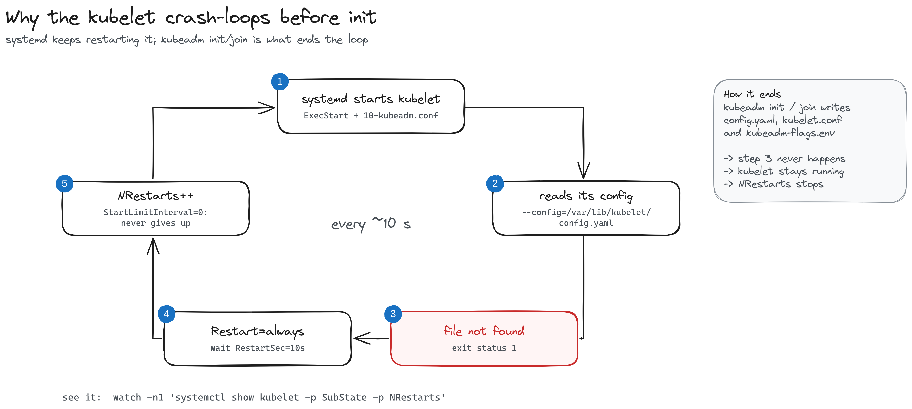
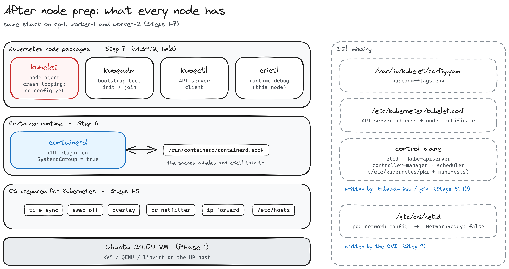

# Phase 2 · Part A — Prepare the nodes

[← Phase 2 index](README.md) · [Part B: bootstrap the cluster →](02-bootstrap-cluster.md)

Three empty Ubuntu VMs in, three nodes ready for `kubeadm` out. Every step runs on **all three nodes**.

## How to run the steps

Each step says **Run on:** all nodes, control plane only, or workers only. SSH into each node by its alias and run the commands there, **one node at a time**, checking the output before moving on:

```bash
ssh cp-1        # then worker-1, then worker-2
```

Always use the alias. `~/.ssh/config` matches the name you type, so `ssh joel@192.168.122.10` skips the ProxyJump and hangs: the workstation has no route to `192.168.122.0/24` (see [Phase 1](../phase-0-1-host-and-vms/README.md)).

| Prompt | You are on | What runs there |
|---|---|---|
| WSL | workstation | `ssh <node>`, `git` |
| `joel@homelab` | HP host | `virsh`, libvirt |
| `joel@cp-1`, `joel@worker-N` | a node | everything in this phase |

> **Tip:** before starting, snapshot the clean VMs on the host. It's an undo button and lets you repeat the whole install:
> `virsh shutdown <vm>` → `virsh snapshot-create-as <vm> clean-nodes` → `virsh start <vm>`; go back with `virsh snapshot-revert <vm> clean-nodes`.

---

## Step 1 — Time synchronization

**Result:** clock synchronized via NTP on all three nodes, RTC in UTC, timezone UTC. No changes needed.

**Run on:** all nodes.

**Why.** All nodes must agree on the time: TLS certificate validity, bootstrap token expiry, etcd and log correlation all depend on it. The timezone itself doesn't matter; UTC is the usual choice for servers.

**Check.**

```bash
timedatectl status
timedatectl timesync-status    # Ubuntu uses systemd-timesyncd (RHEL guides use chronyc)
```

Expected:

```
System clock synchronized: yes
              NTP service: active
          RTC in local TZ: no
```

**Fix, if needed.**

```bash
sudo timedatectl set-ntp true      # enable NTP
sudo timedatectl set-local-rtc 0   # keep the hardware clock in UTC
```

---

## Step 2 — SELinux, AppArmor and firewall

**Result:** SELinux not installed on any node; AppArmor loaded. `sudo ufw status` → `Status: inactive` on `cp-1` (workers to record).

**Run on:** all nodes.

**SELinux.** RHEL-family guides set SELinux to permissive. Ubuntu doesn't use SELinux, so the step doesn't apply. Don't install `selinux-utils`.

```bash
getenforce                 # "command not found" = no SELinux
sudo aa-status | head -3   # AppArmor is Ubuntu's LSM; kubeadm works with it as is
```

**Firewall.** Kubernetes components talk to each other over many ports: the API server (6443), etcd (2379-2380), every kubelet (10250), the CNI's overlay (Flannel uses VXLAN on 8472/udp)... A host firewall that drops any of them breaks the cluster in confusing ways: a worker that can't `join`, `kubectl logs` timing out, pods on different nodes unable to reach each other. So before building the cluster, check whether a firewall is filtering.

Ubuntu ships `ufw` ("uncomplicated firewall"), a front-end that writes iptables/nftables rules (RHEL uses `firewalld` instead), and it's usually inactive on a fresh server. In this lab the VMs sit on a private NAT network that nothing outside the host can reach (Phase 1), so leaving `ufw` off is reasonable; on machines exposed to a real network you'd keep it on and open the ports in the table below.

> **Gotcha:** `systemctl is-active ufw` says `active` even when the firewall is off. The unit is a oneshot that runs at boot and only applies rules if ufw is enabled. The real state is `sudo ufw status` (or `ENABLED=yes|no` in `/etc/ufw/ufw.conf`).

```bash
sudo ufw status                    # expected: Status: inactive
sudo iptables -L INPUT -n | head   # policy ACCEPT, no DROP rules
```

If `ufw` is active, either disable it in the lab (`sudo ufw disable`) or open the ports:

| Node | Ports |
|---|---|
| Control plane | 6443 (API server), 2379-2380 (etcd), 10250 (kubelet), 10257 (controller-manager), 10259 (scheduler) |
| Workers | 10250 (kubelet), 30000-32767 (NodePort) |
| All, CNI | 8472/udp (Flannel VXLAN) or 179/tcp (Calico BGP) |

---

## Step 3 — Disable swap

**Result:** swap 0B and no swap entry in `/etc/fstab` on all three nodes. Ubuntu cloud images ship without swap, so it was already off and persistent.

**Run on:** all nodes.

**Why.** Kubernetes manages memory as if it were physical RAM:

- The scheduler places pods by memory `requests` against node RAM and ignores swap.
- A container over its memory limit should be OOM-killed and restarted. With swap it pages to disk instead, stays "alive" and becomes unusably slow.
- Kubelet eviction thresholds (`memory.available`) become unreliable.
- `Guaranteed` QoS pods lose the guarantee that their memory stays in RAM.

By default the kubelet refuses to start if swap is on (`failSwapOn: true`). Node swap support is GA since v1.34, but opt-in (`failSwapOn: false`, `swapBehavior: LimitedSwap`, cgroup v2 only). This cluster keeps swap off.

> **Note:** this is about the **nodes**. The HP host has 4 GB of swap and that's fine: the kubelet only sees its own VM.

**Check.**

```bash
free -h | grep -i swap      # expected: 0B
swapon --show               # expected: empty
grep -i swap /etc/fstab     # expected: nothing, or commented out
```

**Fix, if needed.**

```bash
sudo swapoff -a                                # off now
sudo sed -i '/\sswap\s/ s/^/#/' /etc/fstab     # off after reboot
sudo rm -f /swap.img                           # Ubuntu's default swap file (optional)
```

A single node with swap left on fails when its kubelet starts after `kubeadm join`.

---

## Step 4 — Kernel modules and sysctl

**Result:** `overlay` and `br_netfilter` loaded and all sysctls at 1 on all three nodes, persistent across reboots.

**Run on:** all nodes.

**Why.** Each VM has its own kernel, and a fresh Ubuntu doesn't load these because nothing needed them yet:

- **`overlay`**: the OverlayFS driver containerd uses to stack image layers into a container's filesystem (same idea as the qcow2 overlays from Phase 1, with files instead of disk blocks).
- **`br_netfilter`**: makes traffic crossing a Linux bridge (pod-to-pod on the same node) go through iptables, so Service rules and NetworkPolicies apply to it. `bridge` shows up in `lsmod` as its dependency.
- **`net.bridge.bridge-nf-call-iptables/ip6tables = 1`**: turns that bridge filtering on for IPv4/IPv6.
- **`net.ipv4.ip_forward = 1`**: lets the node route packets between interfaces (pod network, node network, other nodes).

Load `br_netfilter` **before** applying the sysctls: the `net.bridge.*` keys don't exist until the module is loaded.

**Apply.**

```bash
cat <<EOF | sudo tee /etc/modules-load.d/k8s.conf
overlay
br_netfilter
EOF
sudo modprobe overlay
sudo modprobe br_netfilter

cat <<EOF | sudo tee /etc/sysctl.d/k8s.conf
net.bridge.bridge-nf-call-iptables  = 1
net.bridge.bridge-nf-call-ip6tables = 1
net.ipv4.ip_forward                 = 1
EOF
sudo sysctl --system
```

The files under `/etc/modules-load.d/` and `/etc/sysctl.d/` make both settings survive a reboot. `modprobe` and `sysctl --system` apply them now.

**Verify.**

```bash
lsmod | grep -E 'overlay|br_netfilter'
sysctl net.bridge.bridge-nf-call-iptables net.ipv4.ip_forward   # both = 1
```

---

## Step 5 — Hostname resolution

**Result on `cp-1`:** no `127.0.1.1 <hostname>` line in `/etc/hosts`. Node entries still to add on all nodes.

**Run on:** all nodes.

**Why.** The kubelet registers the node under its hostname, and kubeadm preflight warns if that name doesn't resolve. Each node must resolve every other node's name to its real cluster IP. Some images (and Vagrant) add `127.0.1.1 <hostname>`, which makes the hostname resolve to loopback, so the node registers with the wrong IP. Remove it if present.

**Check.**

```bash
hostnamectl --static     # must match the node name: cp-1, worker-1, worker-2
cat /etc/hosts           # look for a 127.0.1.1 line
```

**Apply.** Append the entries once per node (`tee -a` duplicates them if run twice):

```bash
cat <<EOF | sudo tee -a /etc/hosts

# Kubernetes homelab nodes
192.168.122.10 cp-1
192.168.122.11 worker-1
192.168.122.12 worker-2
EOF
```

If a `127.0.1.1` line exists, remove it:

```bash
sudo sed -i '/^127\.0\.1\.1/d' /etc/hosts
```

> **Gotcha:** if `/etc/hosts` starts with a cloud-init comment about `manage_etc_hosts`, cloud-init rewrites it on every boot. Set `manage_etc_hosts: false` in `/etc/cloud/cloud.cfg` or edit the template instead.

**Verify.** The node resolves and reaches all three names:

```bash
getent hosts cp-1 worker-1 worker-2
ping -c 1 cp-1
ping -c 1 worker-1
ping -c 1 worker-2
```

All three should answer from their `192.168.122.x` address. Repeat from `worker-1` and `worker-2`: every node must reach every other node.

---

## Step 6 — containerd

**Result:** done and verified on `cp-1`. Workers pending.

**Run on:** all nodes.

### What we're installing, and why

The kubelet doesn't run containers itself. It asks a **container runtime** to do it, through a gRPC API called the **CRI** (Container Runtime Interface). containerd is that runtime. Under it, a few more pieces do the actual work:

| Piece | What it is |
|---|---|
| **kubelet** | the node agent; talks CRI to containerd over a Unix socket |
| **containerd** | the daemon: pulls images, stacks their layers, creates and supervises containers |
| **containerd-shim-runc-v2** | one small process per pod; keeps the container alive even if containerd restarts, and reports its exit status |
| **runc** | creates the container (namespaces + cgroups) following the OCI spec, then exits |

So a pod starting looks like: kubelet → (CRI) → containerd → shim → runc → your process.

We install the `containerd.io` package from **Docker's apt repository**: it's the same containerd, just more up to date than Ubuntu's own `containerd` package, and it ships `runc` with it.

### 6.1 Refresh apt and install the tools to add a repository

```bash
sudo apt-get update
sudo apt-get install -y ca-certificates curl
```

- `apt-get update` refreshes the list of available packages. It installs nothing; it just updates the catalogue.
- `curl` will download Docker's signing key. `ca-certificates` is the list of trusted certificate authorities that lets `curl` verify `download.docker.com` over HTTPS is really Docker.

### 6.2 Trust Docker's signing key

```bash
sudo install -m 0755 -d /etc/apt/keyrings
sudo curl -fsSL https://download.docker.com/linux/ubuntu/gpg -o /etc/apt/keyrings/docker.asc
sudo chmod a+r /etc/apt/keyrings/docker.asc
```

- `/etc/apt/keyrings/` is where third-party repository keys live.
- `docker.asc` is Docker's **public GPG key**. `apt` will use it to check that every package from Docker's repo was really signed by Docker, and refuse anything that wasn't.
- `chmod a+r`: `apt` reads the key as an unprivileged user, so it must be world-readable.

### 6.3 Add Docker's repository

```bash
echo "deb [arch=$(dpkg --print-architecture) signed-by=/etc/apt/keyrings/docker.asc] https://download.docker.com/linux/ubuntu $(. /etc/os-release && echo $VERSION_CODENAME) stable" \
  | sudo tee /etc/apt/sources.list.d/docker.list > /dev/null
sudo apt-get update
```

This writes one line to `/etc/apt/sources.list.d/docker.list`. Unpacked:

- `arch=$(dpkg --print-architecture)` → `amd64`.
- `signed-by=...docker.asc` → packages from this repo must be signed with **that** key, and only that key.
- `$(. /etc/os-release && echo $VERSION_CODENAME)` → `noble` (Ubuntu 24.04), so we get packages built for this release.

The second `apt-get update` makes apt read the new repository.

### 6.4 Install containerd

```bash
sudo apt-get install -y containerd.io
containerd --version     # 2.x
```

This installs `containerd`, `runc` and the `ctr` CLI, and creates a systemd unit that starts containerd right away, with a **minimal** config.

### 6.5 Generate the full default config

```bash
containerd config default | sudo tee /etc/containerd/config.toml > /dev/null
head -1 /etc/containerd/config.toml     # version = 3
```

- `containerd config default` downloads nothing: it **prints the default configuration built into the binary**, and `tee` saves it as `/etc/containerd/config.toml`.
- Why: the config shipped by `containerd.io` is minimal and contains `disabled_plugins = ["cri"]`. The CRI plugin, the one the kubelet talks to, is **off**. Replacing it with the full default config turns CRI on.
- `head -1` shows the version of the **config format**, not of containerd. `version = 3` is the containerd 2.x format. Older guides use `version = 2`, with different section names, so their `sed` commands silently don't match.

### 6.6 Use the systemd cgroup driver

```bash
grep -n SystemdCgroup /etc/containerd/config.toml     # SystemdCgroup = false
sudo sed -i 's/SystemdCgroup = false/SystemdCgroup = true/' /etc/containerd/config.toml
grep -n SystemdCgroup /etc/containerd/config.toml     # SystemdCgroup = true
```

This is the critical setting of the whole step.


**cgroups** (control groups) are the kernel feature that limits and accounts CPU and memory for a group of processes. A container's `resources.limits` end up as cgroup settings. Something has to create and manage those cgroups, and there are two **cgroup drivers**:

- **`cgroupfs`**: the runtime writes directly to `/sys/fs/cgroup`.
- **`systemd`**: the runtime asks systemd to create them, as systemd units.

On Ubuntu, **systemd is PID 1 and already manages the cgroup tree** for every service on the machine. The kubelet uses the `systemd` driver by default (kubeadm configures it that way). If containerd used `cgroupfs` at the same time, there would be **two managers for the same tree**, each with its own view of the resources. Under memory pressure that leads to unstable nodes and pods being killed for no clear reason.

`SystemdCgroup = true` makes containerd (through runc) **delegate cgroup management to systemd**, the same as the kubelet. One manager, one consistent view.

### 6.7 Restart and enable

```bash
sudo systemctl restart containerd
sudo systemctl enable containerd
```

- `restart`: containerd only reads `config.toml` at startup, so the new config doesn't apply until it restarts.
- `enable`: start containerd at every boot.

### 6.8 Verify (on every node)

**The config actually loaded.** containerd logs its CRI config every time it starts:

```bash
sudo journalctl -u containerd --no-pager | grep -o '"SystemdCgroup":[a-z]*'
```

On `cp-1` this showed three starts, which tell the whole story:

| When | `SystemdCgroup` | What happened |
|---|---|---|
| Oct 20 20:42:45 | `false` | first start after installing, before the `sed` |
| Oct 20 20:42:50 | `true` | the `restart` after the `sed` |
| Oct 23 14:30:02 | `true` | a later VM boot: `enable` works and the setting persists |

> `journalctl` needs `sudo` (or membership in `systemd-journal`): without it you only see your own user's logs, and the grep returns nothing. A shorter check of the loaded config: `sudo containerd config dump | grep -i systemdcgroup`.

**The sockets.**

```bash
ls -l /run/containerd/containerd.sock
ss -xl | grep containerd
```

- `containerd.sock` is a **Unix socket**: a "port" that lives as a file. The kubelet, `ctr` and `crictl` talk to containerd through it. `ls -l` shows an `s` as the first character of the permissions: s = socket.
- `ss -xl` lists Unix sockets (`-x`) that are listening (`-l`). The file can exist with nobody behind it; this proves containerd is actually listening. There are two:
  - `containerd.sock`: the main API (gRPC);
  - `containerd.sock.ttrpc`: a lightweight gRPC (*ttrpc*) the shims use to talk to containerd with less memory.

**The plugins.** containerd is a small core plus plugins; `ctr plugins ls` shows each one, with `ok` (loaded) or `skip` (not applicable on this machine).

```bash
ctr plugins ls
```

> **Plugins are not processes.** They're modules compiled into the single `containerd` binary, registered when the daemon starts. `ps -ef | grep [c]ontainerd` shows **one** `containerd` process, whatever the plugin list says. New processes only appear when a container runs: one `containerd-shim-runc-v2` per pod plus the container's own processes (`runc` creates the container and exits).

Of the whole list, three do the core work for the kubelet:

- **`cri.v1 runtime`**: answers the kubelet's "run this pod / create this container / stop it" calls, and drives the shims.
- **`cri.v1 images`**: answers "pull this image / which images do you have", and stores the layers on disk (`/var/lib/containerd`).
- **`snapshotter.v1 overlayfs`**: when a container starts, takes that image's layers (read-only) and mounts them with OverlayFS, plus one writable layer on top, as the container's `/`.

Pull an image → `images` downloads the layers → `overlayfs` stacks them → `runtime` starts the container on top.

You can see both facts in systemd's cgroup tree:

```bash
systemd-cgls --no-pager | grep -A2 containerd.service
```

```
  ├─containerd.service …
  │ └─642 /usr/bin/containerd
```

(`grep -A2` hides the parent branch; `systemctl status containerd | grep CGroup` shows the full path, `/system.slice/containerd.service`.)

> **Careful with what this proves.** Being under `system.slice` means systemd started and manages the `containerd` **process**, like any other service; it would look the same with `SystemdCgroup = false`. What `SystemdCgroup` controls is who creates the **containers'** cgroups, and there are no containers yet. The real proof is the journal line above, and later the `kubepods.slice` branch.

`containerd.service` is its own cgroup, created by systemd, with **one** process inside: all those plugins live in PID 642 (the same PID as the `containerd[642]` lines in the journal). Once the cluster runs pods, a `kubepods.slice` branch appears next to it: that's the kubelet and containerd creating pod cgroups **through systemd**, which is exactly what `SystemdCgroup = true` asked for.

The ones Kubernetes needs, all `ok` on `cp-1`:

| Plugin | Role |
|---|---|
| `io.containerd.grpc.v1 cri`, `io.containerd.cri.v1 runtime`, `io.containerd.cri.v1 images` | the CRI API the kubelet uses: run pods, pull images. Off in the minimal config, on after 6.5 |
| `io.containerd.snapshotter.v1 overlayfs` | stacks image layers into the container filesystem, using the `overlay` module from Step 4 |
| `io.containerd.runtime.v2 task`, `io.containerd.shim.v1 manager` | start each container through a shim, which calls runc |
| `io.containerd.podsandbox.controller.v1 podsandbox` | creates the pod sandbox: the `pause` container that holds the pod's network namespace |
| `io.containerd.monitor.task.v1 cgroups` | watches container cgroups (memory, CPU, OOM events) |
| `io.containerd.server.v1 grpc`, `io.containerd.server.v1 ttrpc` | the two sockets above |

The `skip` lines are expected:
- `btrfs`, `zfs`, `devmapper`, `blockfile`, `erofs`: snapshotters for filesystems this VM doesn't use (ext4 + overlay).
- `otlp`, `tracing`: OpenTelemetry tracing, not configured.
- `grpc-tcp`: the API over TCP is off on purpose; containerd only listens on the local socket.
- `metrics`, `debug`: diagnostic endpoints, not configured.

> **Expected noise:** `journalctl -u containerd` may show `no network config found in /etc/cni/net.d`. That's normal: the CNI is installed after `kubeadm init` (Step 9). It didn't show up on `cp-1`.

> **Optional:** pin the version instead of taking the latest: `apt-cache madison containerd.io`, then `sudo apt-get install -y containerd.io=<version>` and `sudo apt-mark hold containerd.io`. In a cluster, components shouldn't upgrade themselves behind your back.

Repeat 6.1-6.8 on `worker-1` and `worker-2`.

---

## Step 7 — kubeadm, kubelet and kubectl

**Result:** `v1.34.12` installed and held on all three nodes; kubelet enabled (crash-looping until init/join, as expected).

**Run on:** all nodes.

### What we're installing, and why

| Package | What it is | Why on every node |
|---|---|---|
| **kubelet** | the node agent: a systemd service that talks to the API server and asks containerd (CRI) to run pods | every node runs pods, the control plane too (its components are static pods) |
| **kubeadm** | the bootstrap tool: `init`, `join`, `upgrade`, `reset` | `init` runs on `cp-1`, `join` on the workers |
| **kubectl** | the CLI client for the API server | only strictly needed where you run commands (`cp-1`, later the workstation), but handy on every node for debugging |

Ubuntu doesn't ship Kubernetes in its own repositories, so first we tell `apt` **where to get it**: the official Kubernetes apt repository, `pkgs.k8s.io`. An apt repository is just a package server address plus the key that signs its packages; `apt install` then downloads the official `.deb` packages from it. Same pattern as Docker's repository for containerd in Step 6.

`pkgs.k8s.io` has **one repository per minor version** (`v1.32`, `v1.33`, ...): the URL you add decides which Kubernetes you get.

**Why packages and not the bare binaries?** You could download `kubelet`, `kubeadm` and `kubectl` and copy them to `/usr/bin` by hand (*Kubernetes The Hard Way* does exactly that). The packages give you, for free:

- the kubelet's **systemd service**, already written (`kubelet.service` + kubeadm's drop-in), instead of writing it yourself;
- the **dependencies**, e.g. the base CNI plugins (`kubernetes-cni`, into `/opt/cni/bin`);
- **signature verification**: apt refuses anything not signed with the repo's key;
- **controlled upgrades**: pin a version now, move to the next one deliberately later.

> **Which version?** This cluster uses **v1.34**, to match the Kubernetes version of the CKA exam I'm preparing. Whatever you pick, use the same minor version in **both** URLs below and on all three nodes.

> **RHEL vs Ubuntu:** RHEL guides add the repo as a `/etc/yum.repos.d/kubernetes.repo` file (`baseurl`, `gpgkey`, `exclude=`). On Ubuntu the same repository is consumed in `deb` format, through `apt`.

### 7.1 Tools to add the repository

```bash
sudo apt-get update
sudo apt-get install -y apt-transport-https ca-certificates curl gpg
```

- `ca-certificates` + `curl`: download the key over verified HTTPS (same as Step 6.1).
- `gpg`: needed to convert the key in 7.2.
- `apt-transport-https`: HTTPS support for apt. Built into modern apt, so it's a harmless no-op on 24.04; kept because the official docs list it.

### 7.2 Trust the Kubernetes signing key

```bash
curl -fsSL https://pkgs.k8s.io/core:/stable:/v1.34/deb/Release.key \
  | sudo gpg --dearmor -o /etc/apt/keyrings/kubernetes-apt-keyring.gpg
```

- `Release.key` is the public key that signs this repository's packages.
- It's published as ASCII text ("armored"); `gpg --dearmor` converts it to the binary format apt expects and saves it under `/etc/apt/keyrings/`.
- Same role as `gpgkey=` + `gpgcheck=1` in a yum `.repo` file.

### 7.3 Add the repository

```bash
echo 'deb [signed-by=/etc/apt/keyrings/kubernetes-apt-keyring.gpg] https://pkgs.k8s.io/core:/stable:/v1.34/deb/ /' \
  | sudo tee /etc/apt/sources.list.d/kubernetes.list
```

- One line in `/etc/apt/sources.list.d/kubernetes.list`: where the repo is, and `signed-by=` ties it to the key from 7.2 (same idea as Docker's repo in 6.3).
- The trailing ` /` means this repo has no "suite" (`noble`, `jammy`...): the same packages serve every Ubuntu release. The version lives in the URL instead.

### 7.4 Install and pin

```bash
sudo apt-get update
sudo apt-get install -y kubelet kubeadm kubectl
sudo apt-mark hold kubelet kubeadm kubectl
```

- `apt-get update` reads the new repo; `install` pulls the three packages plus `kubernetes-cni` (the base CNI plugins: bridge, loopback, host-local...) as a dependency. `cri-tools` (`crictl`) is no longer pulled in automatically: it gets its own step in 7.7.
- `apt-mark hold` freezes them: a routine `apt upgrade` won't touch them. In a cluster, upgrades are deliberate and ordered (`kubeadm upgrade`, control plane first, one minor version at a time). Same role as `exclude=kubelet kubeadm kubectl` in a yum `.repo` file.

### 7.5 Enable the kubelet

```bash
sudo systemctl enable --now kubelet
```

Starts the kubelet now and on every boot.




> **Expected: the kubelet crash-loops.** It starts, looks for its config file `/var/lib/kubelet/config.yaml`, doesn't find it and exits with an error. It never gets as far as looking for an API server. The packaged service has `Restart=always` and `RestartSec=10`, so systemd starts it again every 10 seconds, forever: a node agent is meant to always be running. `kubeadm init` (on `cp-1`) or `kubeadm join` (on the workers) writes that file, and from then on it stays up.
>
> ```bash
> sudo journalctl -u kubelet -n 5 --no-pager        # "failed to load kubelet config file ... /var/lib/kubelet/config.yaml"
> systemctl show kubelet -p Restart -p RestartUSec  # Restart=always, RestartUSec=10s
> ```
>
> Once configured, the kubelet does **not** die when the API server is unreachable: it keeps running and retrying. It has to, because on `cp-1` the kubelet is the one that starts the API server (as a static pod).

### 7.6 Verify (on every node)

```bash
kubeadm version -o short
kubelet --version
kubectl version --client
apt-mark showhold          # kubeadm, kubectl, kubelet
```

All three nodes must report the **same version**. Output on each of the three:

```
v1.34.12
Kubernetes v1.34.12
Client Version: v1.34.12
--- held
kubeadm
kubectl
kubelet
```

The repo is `v1.34`; apt picks the latest **patch** in it (`.12`).

**See the crash-loop yourself.** On any node:

```bash
watch -n1 'systemctl show kubelet -p ActiveState -p SubState -p NRestarts'
```

`SubState` flips between `running` and `auto-restart` (waiting the 10 s before the next start), and `NRestarts` goes up by one every cycle: that's systemd bringing it back. On `cp-1`, a few minutes after installing:

```
NRestarts=17
ActiveState=activating
SubState=auto-restart
```

17 restarts × ~10 s ≈ the 3 minutes since the install. `activating` + `auto-restart` is the gap between two attempts: the kubelet already died and systemd is counting down to the next start. Or follow the log live:

```bash
sudo journalctl -u kubelet -f
# Started kubelet → failed to load kubelet config file ... /var/lib/kubelet/config.yaml
# → Main process exited, status=1/FAILURE → Scheduled restart job, restart counter is at N
```

The real log on `cp-1`, one 10-second cycle:

```
systemd[1]: kubelet.service: Scheduled restart job, restart counter is at 48.
systemd[1]: Started kubelet.service - kubelet: The Kubernetes Node Agent.
(kubelet)[3568]: kubelet.service: Referenced but unset environment variable evaluates to an empty string: KUBELET_KUBEADM_ARGS
kubelet[3568]: E1023 15:10:54.539989 3568 run.go:72] "command failed" err="failed to load kubelet config file, path: /var/lib/kubelet/config.yaml, ... open /var/lib/kubelet/config.yaml: no such file or directory"
systemd[1]: kubelet.service: Main process exited, code=exited, status=1/FAILURE
systemd[1]: kubelet.service: Failed with result 'exit-code'.
```

- `restart counter is at 48`: the same `NRestarts` as in the `watch`.
- `KUBELET_KUBEADM_ARGS` unset: kubeadm's drop-in reads it from `/var/lib/kubelet/kubeadm-flags.env`, another file `init`/`join` will write. Just a warning.
- `failed to load kubelet config file`: the actual reason it exits.

After `kubeadm init` / `join`, the same `watch` shows `NRestarts` frozen and `SubState=running`.

> **Noise you can ignore:** after each `apt-get install`, lines like `No services need to be restarted` come from `needrestart`, which checks whether running services use outdated libraries. Nothing to do.

### 7.7 crictl: a debugging client for the runtime

`cri-tools` (`crictl`) is no longer pulled in by kubeadm, so it has to be installed on its own. Careful: on a missing `crictl`, Ubuntu suggests `critcl`, an unrelated Tcl compiler. Don't install that.

```bash
sudo apt-get install -y cri-tools
sudo apt-mark hold cri-tools
echo 'runtime-endpoint: unix:///run/containerd/containerd.sock' | sudo tee /etc/crictl.yaml
```

- `cri-tools` comes from the same `pkgs.k8s.io` repo as the rest, so its version matches the cluster; `hold` pins it like the others.
- `/etc/crictl.yaml` tells `crictl` which runtime to talk to. `crictl` works with any CRI runtime (containerd, CRI-O...), so it needs to be told. `unix://` means a **Unix socket**, not a TCP address: a file through which two processes on the **same machine** talk. It's the `containerd.sock` from 6.8. Without this file, `crictl` probes several default sockets and prints a warning for each one.

**Why another client, if `ctr` exists?**


| | `ctr` | `crictl` |
|---|---|---|
| talks to containerd through | its **native** API | the **CRI**, the same API the kubelet uses |
| sees | everything in containerd, by namespace (`default`, `k8s.io`...) | what Kubernetes sees: **pods** and their containers |
| used for | poking containerd directly | **debugging a cluster node**: `crictl pods`, `crictl ps`, `crictl logs` |

`kubectl` asks the **cluster** (API server, over the network); `crictl` asks **one node's runtime**, through its local socket, skipping the kubelet. When the API server is down (a failed `kubeadm init`, for instance), `crictl` is how you see what's actually running on a node.

```
kubectl ──(network, :6443)──► API server        the whole cluster
                                  │
                               kubelet  (one per node)
                                  │ CRI
crictl ──(local socket)─────► containerd        this node only
                                  │
                               shim → runc → containers
```

**Check the runtime's state.**

```bash
crictl info | grep -A12 '"conditions"'
```

On `cp-1`:

```
"conditions": [
  {
    "message": "",
    "reason": "",
    "status": true,
    "type": "RuntimeReady"
  },
  {
    "message": "Network plugin returns error: cni plugin not initialized",
    "reason": "NetworkPluginNotReady",
    "status": false,
    "type": "NetworkReady"
  },
```

- **`RuntimeReady: true`**: containerd is up and its CRI answers. This is the line that says the runtime works.
- **`NetworkReady: false`**: no CNI plugin is configured yet. **Expected**: pod networking arrives in Step 9. Until then, the kubelet will report the node as `NotReady`. You're seeing the cause before the symptom.

The top of `crictl info` shows where that network config will come from:

```bash
crictl info | head -30
```

- `Networks`: only `cni-loopback`, the minimal network containerd always sets up so every container gets `lo` (127.0.0.1).
- `PluginConfDir: /etc/cni/net.d`: where containerd looks for network config. Empty now; Flannel will drop a `10-flannel.conflist` there.
- `PluginDirs: /opt/cni/bin`: where the CNI plugin binaries live, from the `kubernetes-cni` package.
- `PluginMaxConfNum: 1`: only the first config file (alphabetical) is used.
- `Prefix: eth`: each pod's interface will be called `eth0`.

Look at both directories yourself:

```bash
ls /opt/cni/bin/
sudo ls /etc/cni/net.d/      # root-only directory: without sudo, "Permission denied"
```

On `cp-1`:

```
README.md  bridge  dummy  host-device  ipvlan  macvlan  ptp  static  tuning  vrf  ...
```

and `/etc/cni/net.d/` is **empty**.

- **`/opt/cni/bin`, the binaries**: small executables, one per job. The container runtime runs them when a pod is created or deleted, passing the pod's network namespace. `bridge` creates a Linux bridge on the node and plugs the pod into it with a veth pair; `host-local` hands out IPs from a range (IPAM); `loopback` sets up `lo`; `portmap` implements `hostPort`. They come from the `kubernetes-cni` package (Step 7).
- **`/etc/cni/net.d`, the config**: says **which** of those binaries to chain together, and with what settings. Empty for now, which is exactly why `crictl info` reports `cni plugin not initialized`.

The CNI we'll install (Flannel, Step 9) fills in both sides: it drops its own `flannel` binary into `/opt/cni/bin` and a `10-flannel.conflist` into `/etc/cni/net.d`. The `flannel` plugin then delegates the local work to `bridge` (plug the pod into the node's bridge) and `host-local` (give it an IP from the node's pod subnet). At that point `NetworkReady` flips to `true` and the node becomes `Ready`.

Repeat 7.1-7.7 on `worker-1` and `worker-2`.

---

## Where we are (after Step 7)

Before creating the cluster, a recap of what each node has now, bottom-up:




1. **The OS is ready for Kubernetes (Steps 1-5).** Clocks in sync (certificates and tokens depend on it), no swap (the scheduler and the OOM killer assume real RAM), the `overlay` and `br_netfilter` modules plus the forwarding/bridge sysctls (container filesystems and pod networking), and every node resolving every other node by name.
2. **A container runtime (Step 6).** containerd, installed from Docker's repo, with the full default config so the **CRI** plugin is on, and `SystemdCgroup = true` so it **delegates cgroup management to systemd**, the same driver the kubelet uses. It can pull images and run containers, but knows nothing about pods, nodes or clusters.
3. **The Kubernetes node packages (Step 7)**, from the official `pkgs.k8s.io` apt repo, pinned to v1.34.12:
   - **kubeadm**: the bootstrap tool. `init` builds the control plane, `join` adds workers.
   - **kubelet**: the node agent, installed as a systemd service (with kubeadm's drop-in). It will take orders from the API server and pass them to containerd over CRI. Right now it crash-loops because it has no config yet.
   - **kubectl**: the client that sends requests to the API server to inspect and change the cluster.

What's still missing is **the cluster itself**: no CA, no certificates, no etcd, no API server. That's what `kubeadm init` creates next.

> [!CAUTION]
> **Troubleshooting shortcut: if a prerequisite is missing, this is what you'll see.**
> Every step above exists to prevent one of these. When a node misbehaves, start here.
>
> | Missing / wrong | Symptom | Check |
> |---|---|---|
> | Clocks out of sync (Step 1) | certificate "not yet valid" / "expired" errors, `join` fails with an invalid or expired token, etcd complaints | `timedatectl` on every node |
> | Firewall filtering (Step 2) | `join` hangs, `kubectl logs`/`exec` time out, pods on different nodes can't reach each other | `sudo ufw status`, `sudo iptables -L INPUT -n` |
> | Swap on (Step 3) | kubelet refuses to start; `kubeadm init`/`join` preflight error | `swapon --show` |
> | `overlay` not loaded (Step 4) | containers fail to start (no snapshotter) | `lsmod \| grep overlay` |
> | `br_netfilter` / bridge sysctls (Step 4) | preflight error; Services don't work between pods on the **same** node | `lsmod \| grep br_netfilter`, `sysctl net.bridge.bridge-nf-call-iptables` |
> | `ip_forward = 0` (Step 4) | preflight error; no traffic between nodes' pods | `sysctl net.ipv4.ip_forward` |
> | Hostname → `127.0.1.1` (Step 5) | node registers with the wrong IP; other nodes can't reach its kubelet | `getent hosts $(hostname)` |
> | CRI plugin disabled in containerd (Step 6) | `kubeadm init`: "container runtime is not running"; kubelet can't talk to containerd | `crictl info`, `ctr plugins ls \| grep cri` |
> | `SystemdCgroup = false` (Step 6) | unstable node: pods restarting for no clear reason, control plane pods flapping after `init` | `sudo containerd config dump \| grep SystemdCgroup` |
> | Mismatched versions (Step 7) | `join` refused, or a kubelet newer than the control plane | `kubeadm version`, `kubelet --version` on every node |
> | No CNI (Step 9) | nodes `NotReady`, CoreDNS `Pending`, `NetworkReady: false` | `crictl info`, `kubectl get nodes` |
>
> Not a bug: before `init`/`join`, the kubelet crash-loops because `/var/lib/kubelet/config.yaml` doesn't exist yet (see 7.5).

## Things that bit me

- **`systemctl is-active ufw` said `active`, but the firewall was off.** It's a oneshot unit; `sudo ufw status` is the real answer.
- **Ran the node loop on the host.** `for n in cp-1 ...; ssh $n ...` from `joel@homelab` fails with `Could not resolve hostname cp-1`: the aliases only exist in the workstation's `~/.ssh/config`, and the host doesn't have the key the VMs trust anyway.
- **"Swap must be off" ≠ the host's swap.** The requirement is for the nodes.

<!-- keep adding -->
